# How Much Does NEON SIMD Buy on One Apple M5 Max Core? A Measured Study of Scalar and Vector Code

ECSE 4320/6320, Class-wide Project 1: SIMD Advantage Profiling

## Abstract

How much does single-thread NEON vectorization improve SAXPY, multiply, dot product and a 3-point stencil on an Apple M5 Max, and why does the gain change with baseline, working set and access pattern? Scalar and auto-vectorized builds were timed from 4 KiB to 2 GiB, with a pointer-chase latency probe, alignment, stride and gather tests, a roofline, and compiler output. f32 SAXPY is 5.2x faster than the default scalar build but 2.1x faster than an unrolled loop, and 1.35x in DRAM. SAXPY bandwidth stays at 147 to 154 GiB/s from 256 KiB to 1 GiB while load latency rises from 0.7 to 111 ns, which points to a core-side limit (mechanism untested). Of the 13.6x fast-math dot-product gain, 8.4x comes from independent accumulators and 1.7x from SIMD. Offsetting y alone by 4 B slows SAXPY by 26%. No hardware counters or core pinning were available.

## 1. Introduction

A programmer who vectorizes a loop expects a speedup close to the number of SIMD lanes. This study tests that expectation on one core of a current Arm laptop chip and asks six questions in sequence. How large is the gain once the scalar baseline is chosen honestly? Where, in the memory hierarchy, does it shrink, and why is the bandwidth curve so flat? Why does the dot product behave so differently from SAXPY? What do misalignment, short loops, strides and gathers cost? Where do the kernels sit on a roofline? And what do deliberately flawed experiments teach about benchmarking?

Background needed. NEON registers are 128 bits wide: 4 lanes of f32 or u32, 2 lanes of f64. Arithmetic intensity (AI) is floating-point operations per byte moved; a roofline bounds performance by min(peak FLOP rate, AI x bandwidth), and the ridge point (peak divided by bandwidth) separates memory-bound from compute-bound kernels. Little's Law relates bandwidth, latency and concurrency: bytes in flight equal bandwidth times latency, so a fixed number of outstanding misses fixes the bandwidth reachable at a given latency. Floating-point addition is not associative, so a compiler may not reorder a reduction unless allowed; a strictly ordered sum is a chain of dependent adds whose speed is set by add latency, not by vector width.

Expectations for each question were written down before the corresponding measurements were made. A short trial run on three working-set sizes, made to validate the harness after the first expectations were written, showed three facts: the default scalar loop is not unrolled and runs at about one iteration per cycle, the f32 dot product is vectorized at plain `-O3` but with a serial summation, and SAXPY at 1 GiB already ran near 149 GiB/s. Expectations written afterwards (tail behaviour, the effect of removing `restrict`, strides and gather, the roofline and the negative cases) could have been influenced by these facts; the earlier expectations were not changed.

## 2. Experimental setup and methodology

| item | setting |
|---|---|
| Chip | Apple M5 Max, 18 cores: 6 "Super" (L1D 128 KiB, L2 16 MiB shared by the 6) and 12 "Performance" (L1D 64 KiB, L2 8 MiB shared by 6); 36 GiB unified memory; no SMT (logical equals physical core count in both tiers); system-level cache (SLC) size not exposed by the OS |
| Memory geometry | 128 B cache lines, 16 KiB pages |
| Vector unit | NEON, 128 bit; SME is present but not used (streaming mode, not a drop-in SIMD path) |
| Software | macOS 26.5.2, Apple clang 21.0.0, C11, Python 3.13 with numpy and matplotlib |
| Kernels | SAXPY `y = a*x + y` (2 FLOP, 12 B per f32 element), multiply `z = x*y` (1 FLOP, 12 B), dot product (2 FLOP, 8 B), stencil `y[i] = .25 x[i-1] + .5 x[i] + .25 x[i+1]` (5 FLOP, 8 B), each in f32, f64 and u32 (wrap-around integers); strided SAXPY, random gather and further memory kernels where stated. Each kernel, type and build is its own translation unit called through a function pointer; results are sunk behind compiler barriers so nothing is hoisted or removed |
| Data | fixed seed; f32 and f64 uniform in [0.5, 1.5) (no denormals); u32 random odd integers; arrays are first touched during initialization, outside timing; the in-place operand of SAXPY is re-initialized before every sample; SAXPY uses a = 1e-6 so that y stays near 1 |
| Timing | 24 MHz counter (41.7 ns tick); each sample runs the kernel for at least 1 ms; call overhead (0.7 to 0.9 ns) subtracted; median with interquartile-range (IQR) error bars; thermal pressure level read before and after every sample (no sample was throttled); AC power, Low Power Mode off, `caffeinate` around every run |
| Repetitions | 15 samples per point (3 passes x 5 repetitions, configuration order reshuffled each pass) in all sweeps and probes; 15 repetitions per accumulator count (FMA peak); 10 per process (multi-process triad); 5 per naive-benchmark variant |
| Placement | harness thread at QoS user-interactive; macOS cannot pin threads |
| Counters | none available (see below) |

*Table 1. Platform and measurement settings.*

| build | flags | role |
|---|---|---|
| `scalar` | `-O3 -fno-vectorize -fno-slp-vectorize -ffp-contract=on` | default scalar loop |
| `scalar_unroll8` | as `scalar` plus an unroll-by-8 pragma | primary scalar baseline |
| `auto` | `-O3 -ffp-contract=on` | auto-vectorized |
| `native` | `-O3 -mcpu=native -ffp-contract=on` (resolves to `apple-m4`) | CPU-specific |
| `fastmath` | `-O3 -ffast-math -ffp-contract=fast` | reductions may be reordered |
| `auto_norestrict`, `scalar_norestrict` | `auto` or `scalar` with `restrict` removed from the kernel parameters | aliasing study |
| `auto_forcevec` | `auto` plus `#pragma clang loop vectorize(enable)` | forced vectorization of strided loops |

*Table 2. Builds. Fused multiply-add contraction is on everywhere except fast-math, so `a*x + y` becomes `fmadd` (scalar) or `fmla` (vector) in all builds.*

Baselines. The default scalar loop is not unrolled: it executes 6 instructions per element and runs at 1.02 cycles per element, bound by loop overhead. A scalar loop unrolled by 8 runs at 0.41 cycles per element for f32 SAXPY. Because the default loop leaves 2.5x of scalar performance unused, it would inflate any SIMD speedup; the unrolled loop is therefore the primary, conservative baseline, and the default loop is reported as a second reference.

Sessions. Cycle counts use the clock estimate of their own session. Session A: locality sweeps, data types and noise (clock 4.586 GHz). Session B: alignment, tail, stride and gather (4.584 GHz). Session C: triad, FMA peak, multi-process bandwidth, aliasing, reduction accuracy and the naive benchmark (4.574 GHz). Session D, run later, with a video player active and a virtual machine and a torrent client closed beforehand: pointer chase, traffic accounting, dot-product decomposition, relative misalignment and stride-jump probes (4.547 GHz). Load average was 1.2 to 2.4 in sessions A to C and 2.8 to 3.4 in session D.

Frequency policy and clock. macOS offers no frequency control. The effective clock was estimated in each session from a chain of 64 dependent integer adds per loop body, assuming one cycle per add: 4.586 GHz (IQR half-width 0.014) in session A, 4.584 (0.017) in B, 4.574 (0.022) in C and 4.547 (0.037) in D. A dependent integer multiply chain gave 3.00 cycles and a dependent scalar `fmadd` chain 3.08 cycles at the session A clock, which supports the one-cycle-add assumption. Power sampling taken after sessions A to C showed the Performance clusters topping out at 4380 MHz and the Super cluster at 4608 MHz, so a 4.58 GHz chain must have run on a Super core. During an f32 SAXPY run (32 MiB working set) four 1 s samples showed the Super cluster fully active at 4608 MHz per busy core, with cluster averages of 4548 to 4596 MHz; the six Super cores each carried 10 to 35% of the load, so the thread migrated among them. Only this one benchmark was sampled; placement during the others is assumed, not measured. Cycles per element carry about 1% uncertainty from clock variation, and the 128 KiB L1 cliff seen in the sweeps (not 64 KiB, the Performance-core size) agrees with Super-core execution. The `background` QoS class runs on a slow cluster (about 1.3 GHz) and was not used.

Counters. No `perf` exists on macOS. A recording with the system profiler's CPU Counters template produced only aggregate cycle and bottleneck metrics whose cycle totals disagreed with timing by about 4.7x for a known workload; no counter data are used anywhere in this report. Claims about vector instructions, FMA pipes and cache misses rest on disassembly and timing.

Correctness. Every kernel, type and build was checked over 29 sizes (0 to 100003, including every remainder modulo 4, 8, 16, 32 and 64) and 7 start offsets with 64-element guard regions, against a double-double reference (on this ABI `long double` is only 64 bits and adds no precision). Tolerances: at most 1 ulp for SAXPY, multiply, triad, strided and gather (observed 0); 2 ulp for the stencil (observed 1); exact modulo 2^32 for u32; dot-product relative error at most N times the type's epsilon. A separate suite covers the later kernels (memory-traffic kernels and dot products with 1, 4, 8, 16 accumulators). In total 80,562 checks pass. A mutation check confirms the suite can fail: an off-by-one loop bound produced 191 failures and a wrong stencil weight 177.

## 3. Vectorization verification

| kernel and build | vectorized? | width x interleave | elements per iteration |
|---|---|---|---|
| SAXPY, multiply, stencil, `auto` (f32, u32) | yes | 4 x 4 | 16 |
| same, f64 | yes | 2 x 4 | 8 |
| dot f32, `auto` (strict) | multiply only; sum is 16 serial scalar `fadd` | 4 x 4 | 16 |
| dot u32, `auto` | yes, 4 `mla.4s` accumulators (integer add is associative) | 4 x 4 | 16 |
| dot f32, `fastmath` | yes, 4 vector accumulators (16 partial sums), 10 instructions per iteration | 4 x 4 | 16 |
| strided SAXPY (stride 2 to 48), gather, `auto` | no: cost model reports vectorization not beneficial; scalar loop interleaved 4x | none | 4 (scalar) |
| strided SAXPY and gather, `auto_forcevec` | yes: `ld2.4s` at stride 2, 2-lane `zip1` at stride 8, lane inserts for the gather, scalar or lane stores | | |
| SAXPY, `auto_norestrict` | yes, behind a runtime overlap check with a scalar fallback (51-instruction region) | 4 x 4 | 16 |
| `scalar` / `scalar_unroll8` | no: "loop not vectorized"; 6 instructions per element, resp. 8 `fmadd` per 8 elements, paired `ldp`/`stp` | none | 1, resp. 8 |

*Table 3. What the compiler did. NEON has no masking, so tails run in extra loops.*

Annotated excerpt, SAXPY f32 `auto` (`x1` = x, `x2` = y, `v0[0]` = a):

```
38: ldp  q1, q2, [x9, #-0x20]   ; load 8 floats of x  (ldp = two 128-bit loads)
3c: ldp  q3, q4, [x9], #0x40    ; 8 more floats of x, advance 64 B -> 16 floats of x
40: ldp  q5, q6, [x10, #-0x20]  ; 8 floats of y
44: ldp  q7, q16, [x10]         ; 8 more floats of y             -> 16 floats of y
48: fmla.4s v5,  v1, v0[0]      ; y += a*x on 4 lanes, fused multiply-add
4c: fmla.4s v6,  v2, v0[0]      ; four independent fmla = interleave count 4
50: fmla.4s v7,  v3, v0[0]
54: fmla.4s v16, v4, v0[0]
58: stp  q5, q6, [x10, #-0x20]  ; store 8 results
5c: stp  q7, q16, [x10], #0x40  ; store 8 results, advance
60: subs x11, x11, #0x10        ; 16 elements per trip; b.ne loops, no mask or predicate
90: ldr q1,[x11],#0x10 ... fmla.4s v2,v1,v0[0] ... str q2,[x10],#0x10   ; 4-element vector loop
c0: ldr s1,[x9],#4 ... fmadd s1,s0,s1,s2 ... str s1,[x10],#4          ; scalar epilogue
```

Compiler remark for this loop: `vectorized loop (vectorization width: 4, interleaved count: 4)`. For strided SAXPY (stride 2) the remark is `the cost-model indicates that vectorization is not beneficial`, followed by `interleaved loop (interleaved count: 4)`, which is scalar code. Two early findings shaped the build: `restrict` on local pointers was ignored (the runtime overlap checks stayed), because clang derives `noalias` only from function parameters, so the kernels were restructured; and the two `-Rpass` options must be passed as one comma-separated option, otherwise the second overrides the first.

## 4. Results

### 4.1 How much does SIMD buy?

**Question.** Against a fair scalar baseline, how close does auto-vectorized NEON come to the lane count, and does it depend on kernel, type and working set?

**Expectation.** In L1, where loads, stores and arithmetic dominate, f32 SAXPY, multiply and stencil should gain between 2.5x and 4x over an unrolled scalar loop (below the lane count, because the scalar loop is already unrolled and loop overhead is small), and f64 about half of that (1.5x to 2x). u32 should behave like f32. In DRAM both versions wait on the same memory, so the gain should shrink to 1.0x to 1.3x. The f32 dot product was expected not to vectorize at plain `-O3` (about 1.0x) and to gain 2x to 4x with fast-math.

**Method.** Four builds were swept from 4 KiB to 2 GiB for every kernel and type (Session A).

**Result.** Table 4 gives the speedup of `auto` over `scalar_unroll8` (over `scalar` in parentheses); Table 5 gives the achieved rates of `auto`.

| kernel | f32 L1 (32 KiB) | f32 L2 (4 MiB) | f32 DRAM (1 GiB) | f64 L1 | f64 DRAM |
|---|---|---|---|---|---|
| SAXPY | 2.08 (5.18) | 1.37 (3.05) | 1.35 (3.03) | 1.07 (2.63) | 1.02 (1.55) |
| multiply | 2.20 (5.17) | 1.07 (2.39) | 1.17 (2.51) | 1.07 (2.52) | 1.04 (1.29) |
| stencil | 2.92 (3.77) | 2.57 (3.37) | 2.54 (3.33) | 1.47 (1.95) | 1.38 (1.83) |
| dot, strict `-O3` | 1.46 (1.63) | 1.52 (1.59) | 1.48 (1.59) | 1.39 (1.56) | 1.40 (1.51) |
| dot, `-ffast-math` | 13.6 | 11.5 | 10.1 | 6.7 | 5.0 |

*Table 4. Speedup of the vector build over the unrolled scalar build (default scalar build in parentheses), median ratio. u32 in L1: SAXPY 2.65x, multiply 2.30x, stencil 1.93x, dot 5.9x.*

| kernel | f32 cycles per element, L1 / L2 / DRAM | f32 GiB/s | f64 cycles per element | f64 GiB/s |
|---|---|---|---|---|
| SAXPY | 0.197 / 0.332 / 0.348 | 261 / 154 / 147 | 0.399 / 0.667 / 0.701 | 257 / 154 / 146 |
| multiply | 0.198 / 0.421 / 0.426 | 259 / 122 / 120 | 0.409 / 0.844 / 0.847 | 251 / 121 / 121 |
| dot, strict | 2.09 / 2.16 / 2.17 | 16.4 / 15.8 / 15.8 | 2.08 / 2.20 / 2.29 | 32.8 / 31.0 / 29.9 |
| stencil | 0.274 / 0.307 / 0.321 | 125 / 111 / 106 | 0.539 / 0.579 / 0.593 | 127 / 118 / 115 |

*Table 5. Achieved rate of the `auto` build (GiB/s of compulsory bytes; GFLOP/s follows from Table 11).*

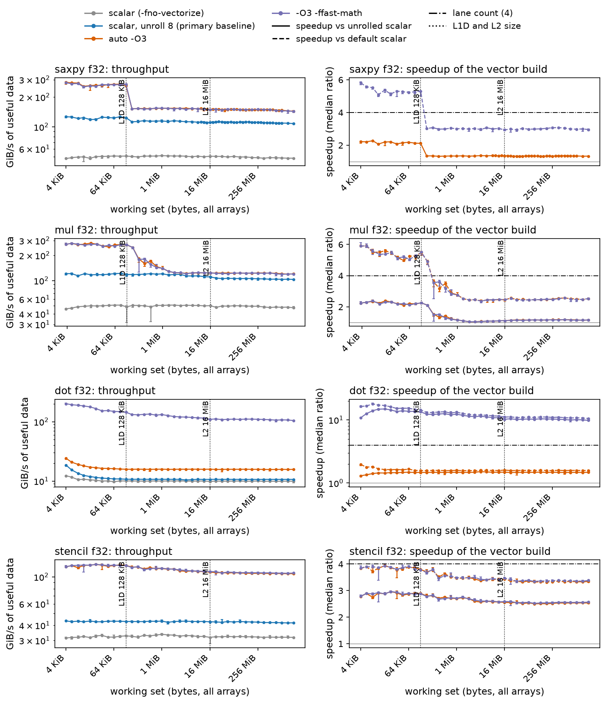

*Figure 1. f32 throughput (left) and speedup over both scalar builds (right) versus working set, one row per kernel, IQR bars; look for the single step at the 128 KiB L1 boundary and no feature at 16 MiB (plots/exp1_sweep_f32).*

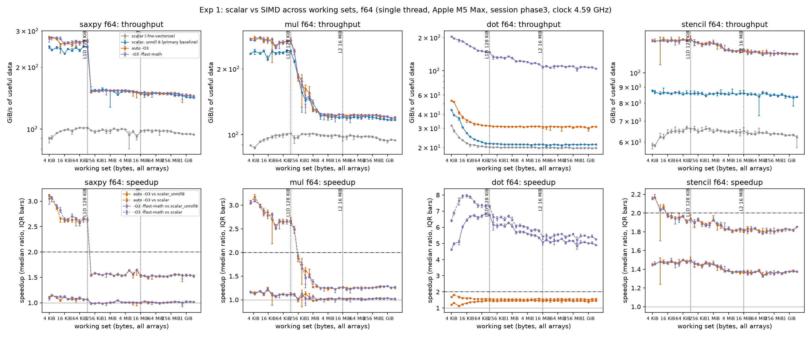

*Figure 2. f64 speedups in the same layout; the dash-dotted line is the lane count (2); look for SAXPY and multiply staying near 1x over the unrolled loop (plots/exp1_sweep_f64).*

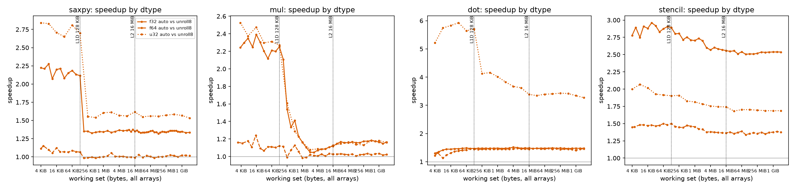

*Figure 3. Speedup of `auto` over unrolled scalar for f32, f64 and u32; look for u32 tracking f32 and f64 sitting lower (plots/exp5_dtype).*

**Explanation.** The gain over the default scalar build (5.2x for f32 SAXPY) exceeds the lane count of 4 because that baseline wastes cycles: it runs at 1.02 cycles per element, against 0.41 unrolled and 0.197 vectorized (Table 5 and the disassembly in the previous section). Over the unrolled baseline the f32 gain is 2.08x, below the expected 2.5x to 4x for SAXPY and multiply and inside it for the stencil (2.92x). The data-type pattern follows from bytes moved per cycle, which can be computed from the cycle counts: counting 12 B per f32 and 24 B per f64 element, the f32 vector loop moves 61 B per cycle, the f64 vector loop 60 B per cycle, the f64 unrolled loop 56 B per cycle, but the f32 unrolled loop only 29 B per cycle. The unrolled scalar loops already use paired loads and stores (`ldp d1, d2` moves 16 B), so for f64 they come within 7% of the vector loop (0.43 against 0.40 cycles per element), while f32 scalar code moves half as many bytes per instruction and the vector loop doubles its rate. L1 appears to cap this kernel at about 60 counted bytes per cycle; this is an inference from rates, since no counters were available. u32 follows f32 because its vector loop is as fast (0.193 cycles) while its scalar loop is slower (0.51 against 0.41 cycles per element); why the scalar integer loop is slower is open (hypothesis, not tested: integer `madd` issues on fewer pipes than `fmadd`; test: a throughput microbenchmark of each instruction). The stencil gains most because its scalar loop is slowest (0.80 cycles per element, 5 FLOP per element) while the vector loop needs only 3 vector arithmetic operations per 4 outputs (4 `fmul` and 8 `fmla` per 16 outputs in the compiled loop). Multiply gains less than SAXPY in DRAM (1.17x against 1.35x) because it writes a third array: its rate is 120 GiB/s against 147 GiB/s for SAXPY, the same gap that the traffic experiment shows for out-of-place patterns. Finally, the gain compresses at the L1 boundary (SAXPY 2.08x to 1.37x between 128 KiB and 256 KiB), not at the 16 MiB L2 boundary or in DRAM as expected: beyond L1 the vector loop runs at about 35 B per cycle and the unrolled scalar loop already reaches 74% of that rate (109 against 147 GiB/s at 1 GiB, Figure 1).

The dot product contradicts the expectation. At plain `-O3` it is vectorized, but the vector multiply feeds a serial chain of scalar `fadd`s (Table 3), so the strict version gains only 1.46x and sits at about 2.1 cycles per element at every size; fast-math, which permits 16 partial sums, gains 13.6x in L1. That gain is far above the lane count, so it cannot come from lanes alone; the dot-product section decomposes it.

**Implication.** Quote SIMD speedups against an unrolled scalar loop and against the default build separately, and compare cycles per element or bytes per cycle, not only ratios; lane count predicts the gain only when the scalar loop leaves most of the load/store capability idle.

### 4.2 Where do gains compress, and why is the bandwidth flat?

**Question.** The speedup falls where data stop fitting in L1; what limits the vector loop beyond it, and does the limit move with each cache level?

**Expectation.** SAXPY bandwidth should step down at the L1 boundary (128 KiB), again near the L2 size (16 MiB), and again where an SLC, if any, gives way to DRAM. A pointer chase should show a load-to-use latency of 3 to 4 cycles in L1, 12 to 20 cycles in L2 up to 16 MiB, a distinct intermediate step from the SLC (25 to 70 ns) between 16 and 256 MiB, and 90 to 140 ns in DRAM. If bandwidth were limited by a fixed number of outstanding misses, the lines in flight (bandwidth x latency / 128 B) would stay constant across levels; if instead it were limited by a fixed transfer rate fed by prefetching, they would grow with latency.

**Method.** SAXPY f32 was swept from 4 KiB to 2 GiB with extra density above 8 MiB (Session A). A pointer chase (Session D) links one 128 B node per cache line into a single random cycle (Sattolo shuffle); the program walks the cycle first and aborts unless every node is visited once and the walk returns to the start after exactly N steps. Each load depends on the previous one, so the time per step is the load-to-use latency of the level holding the working set. A second chase placed one node per 16 KiB page, so that few cache lines but many pages are touched.

**Result.**

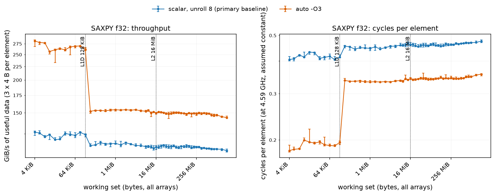

*Figure 4. f32 SAXPY throughput (left) and cycles per element (right) from 4 KiB to 2 GiB with the L1D and L2 sizes marked; look for one step at 128 KiB and a flat plateau afterwards (plots/exp2_saxpy_locality).*

| region | latency | cycles (4.55 GHz) |
|---|---|---|
| 4 to 92 KiB | 0.66 ns | 3.0 |
| 152 to 190 KiB | 1.95 to 2.3 ns | 9 to 10 (transition) |
| 256 KiB to 0.7 MiB | 2.6 ns | 12 |
| 1.25 to 11 MiB | 7.1 to 9.4 ns | 32 to 43 |
| 13.5 to 54 MiB | 18.8 to 94 ns, rising smoothly | 86 to 430 |
| 76 MiB and above | 100 to 106 ns (111 ns from 512 MiB to 1.7 GiB) | 455 to 504 |

*Table 6. Pointer-chase latency by working-set region.*

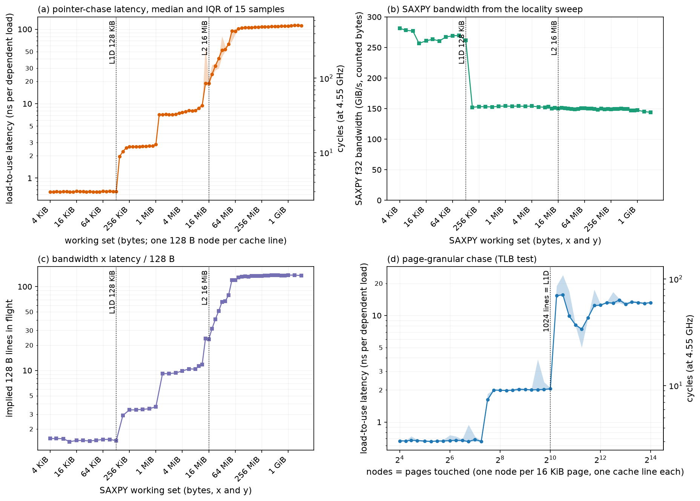

*Figure 5. (a) chase latency with a cycle axis, (b) the SAXPY bandwidth curve, (c) lines in flight implied by bandwidth x latency / 128 B, (d) page-granular chase; look for latency steps at 128 KiB, about 1 MiB and about 13 MiB in (a) against a flat curve in (b) (plots/exp9_chase_latency).*

f32 SAXPY runs at 261 GiB/s (0.197 cycles per element) in L1 and at 147 to 154 GiB/s (0.33 to 0.35 cycles) from 256 KiB to 1 GiB, declining slowly to 144 GiB/s at 2 GiB. Multiply (three arrays) declines gradually between 128 KiB and 2 MiB. The `native` build equals `auto` within 3%; median coefficient of variation is 1.8% in cache and 1.6% in DRAM (90th percentile 5%, a few points up to 47%). Lines in flight, from Session A bandwidth and Session D latency, are 3.7 at 1 MiB, 9.9 at 4 MiB, 23.6 at 16 MiB and 137 at 1 GiB. Twelve concurrent single-thread processes reach an aggregate triad bandwidth of 441 GiB/s, 3.6x one process (Figure 12 in the roofline section).

**Explanation.** The chase confirms the L1 expectation (3.0 cycles, step at 152 KiB) and the DRAM expectation (111 ns). It does not confirm a single L2 plateau: latency is 12 cycles up to about 0.7 MiB and 32 to 43 cycles from about 1.25 MiB to 11 MiB, with a rise at 13.5 MiB consistent with the 16 MiB L2 capacity. It shows no distinct SLC plateau: from 16 MiB to 76 MiB latency climbs smoothly from 19 ns to 94 ns, then is flat from 76 MiB. No SLC size is claimed. The step near 1 MiB matches no cache size reported by the OS. The page-granular chase tested whether it is a TLB-reach effect: with one node per page it stayed at the L1 latency (0.67 ns) from 16 to 152 pages, covering the 48 to 80 pages at which the step appears in the line-granular chase, so the 1 MiB step is not L1 TLB reach. Its cause is unknown (hypothesis, not tested: an unreported cache level or a capacity or associativity effect of the L2; test: chases with different node strides and alignments to separate capacity from conflict misses). The page-granular curve rises to about 2.0 ns near 181 pages and to about 15 ns once its 1024 lines exceed L1; the first rise is consistent with a first-level TLB of roughly 170 entries, which is an inference, not a measurement.

The flat bandwidth is therefore not explained by latency. Between 4 MiB and 1 GiB latency rises 14.6x while bandwidth falls 5% (154 to 147 GiB/s), so the lines in flight grow from 9.9 to 137: a fixed outstanding-miss limit is excluded. A per-core transfer limit of about 35 counted bytes per cycle (147 GiB/s at 4.586 GHz), fed by hardware prefetch, fits the data. DRAM is not the limit either, because 12 processes together reach 441 GiB/s. The in-core mechanism is open (hypothesis, not tested: the rate at which L2 or the fabric can fill L1 and absorb stores; test: load-only and store-only variants of the streaming loop, or counters). The dip near 16 to 32 KiB in the SAXPY curve (about 255 against 275 GiB/s) is repeatable and unexplained.

**Implication.** For a streaming loop, bandwidth beyond L1 is set by the core, so extra data reuse or blocking for L2 or SLC will not help one thread; only reducing bytes per element, or adding cores, will.

### 4.3 The dot product: dependence chains versus lanes

**Question.** The strict f32 dot product gains only 1.46x while the fast-math version gains 13.6x, far above the lane count of 4. How much of the gain is vector width, and how much is independent accumulation?

**Expectation.** A scalar loop with one accumulator should run at the latency of a fused multiply-add, about 3.1 cycles per element. Four accumulators should bring it to 0.7 to 1.0 cycles and 8 or 16 accumulators to 0.5 to 0.7 (two loads per element). Breaking the chain should explain 4x to 6x of the gain and SIMD the remaining 2.3x to 3.5x. In DRAM a 16-accumulator scalar loop should be 2x to 3x slower than the NEON fast-math build.

**Method.** Dot products with 1, 4, 8 and 16 independent source-level partial sums (so no reordering permission is needed) were built as scalar (`-fno-vectorize -fno-slp-vectorize`) and as `auto`, and compared with the plain loop in the unrolled, `auto` and fast-math builds (Session D).

**Result.** Cycles per element, f32 first and f64 in parentheses:

| build | L1 (32 KiB) | L2 (4 MiB) | DRAM (1 GiB) |
|---|---|---|---|
| plain strict loop, unrolled scalar (baseline) | 3.01 (2.91) | 3.17 (3.20) | 3.20 (3.26) |
| 1 accumulator, scalar | 3.39 (3.38) | 3.39 (3.40) | 3.44 (3.47) |
| 4 accumulators, scalar | 0.90 (0.88) | 0.94 (0.94) | 0.96 (0.97) |
| 8 accumulators, scalar | 0.46 (0.44) | 0.48 (0.58) | 0.49 (0.64) |
| 16 accumulators, scalar | 0.36 (0.37) | 0.38 (0.58) | 0.40 (0.64) |
| 16 accumulators, NEON (`auto`) | 0.23 (0.35) | 0.29 (0.56) | 0.32 (0.65) |
| plain loop, `-ffast-math` | 0.21 (0.45) | 0.30 (0.59) | 0.32 (0.64) |
| chain-break gain (baseline / best scalar) | 8.4x (7.9x) | 8.2x (5.5x) | 8.0x (5.1x) |
| SIMD gain (best scalar / fast-math) | 1.67x (0.81x) | 1.29x (0.97x) | 1.25x (0.99x) |
| total (baseline / fast-math) | 14.0x (6.4x) | 10.6x (5.4x) | 10.0x (5.1x) |

*Table 7. Dot-product decomposition (4.55 GHz clock). The same ratio was 13.6x in the earlier sweep (Table 4).*

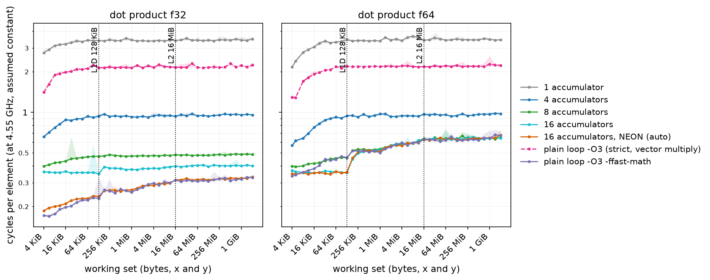

*Figure 6. Cycles per element versus working set for 1, 4, 8 and 16 scalar accumulators, the NEON build of the 16-accumulator code and the plain loop with strict and fast-math summation; look for the chain-bound curves (3.4 and 2.2) far above the accumulator curves and the f64 curves merging at 0.6 beyond L1 (plots/exp11_dot_decomposition).*

**Explanation.** The single-accumulator loop runs at 3.39 cycles per element, close to the 3.08 cycles measured for a dependent `fmadd` chain (see the setup section), so it is bound by add latency. Four accumulators cut this by 3.8x, as independent chains overlap. With 8 and 16 accumulators the scalar loop reaches 0.46 and 0.36 cycles per element, faster than the expected 0.5 to 0.7, because the compiled loop loads two elements per instruction (`ldp s, s`, seen in the disassembly of the 16-accumulator object), so it needs one load operation per element and is bound by load throughput, not by latency. NEON on the same code adds 1.7x in f32 L1 (0.36 to 0.23 cycles). The result contradicts the expected split: dependence-chain breaking accounts for 8.4x of the 14.0x, SIMD for 1.7x. In DRAM, where the memory limit of about 0.32 cycles per element applies, the best scalar loop (0.40) is only 1.25x slower than the vector one. In f64 the 16-accumulator scalar loop equals the NEON build beyond L1 (0.58 to 0.64 against 0.56 to 0.65), so SIMD gives nothing; both move 8 B elements at the same rate, consistent with the load-bound reading above. The strict plain loop (2.1 to 2.2 cycles per element) is the serial `fadd` chain behind vectorized multiplies, which is why it does not scale with lanes. The 1-accumulator loop is 9% slower than the strict unrolled loop (3.39 against 3.01; hypothesis, not tested: loop overhead on the critical path; test: unroll the 1-accumulator loop).

**Implication.** The fast-math "vectorization win" of a reduction is mostly an accumulator-count win; writing the reduction with several independent accumulators recovers most of it without relaxing floating-point semantics, and SIMD then adds a smaller factor.

### 4.4 Alignment and tails

**Question.** How much does the start address of the arrays cost a vector loop, does it matter which array is misaligned, and what do short loops and remainders cost?

**Expectation.** Shifting both arrays by 0 to 64 B should change SAXPY throughput by under 5% in L1 and L2 and under 3% in DRAM, because misaligned accesses should be handled in hardware at little cost; relative misalignment between x and y was expected to matter per stream, not through the offset difference. For tails, loops with N below 64 should cost 3x to 10x more per element than long loops, with a visible dependence on N modulo 4 and modulo 16 below about N = 256 (a sawtooth) and a fixed cost of 5 to 15 ns.

**Method.** First both arrays were shifted equally by 0 to 132 B (Session B). Then x and y were shifted independently over 0, 4, 8, 16, 32 and 64 B at 32 KiB and 256 MiB (Session D). Tails: SAXPY for N = 1 to 160 and around N = 256, 1024, 4096 and 16384 (Session B).

**Result.** With both arrays shifted equally, offsets that are multiples of 16 B ran at the offset-0 speed (within 1%); every other offset (4, 8, 12, 20, 28, 60, 124, 132 B) was 40% slower at 32 KiB, 24% at 4 MiB and 21% at 256 MiB; the unrolled scalar loop varied by at most 6%. Table 8 gives the independent shifts for the `auto` build.

| offsets (x, y) | 32 KiB | 256 MiB |
|---|---|---|
| x only, 4 B | 1.06 | 1.07 |
| y only, 4 B | 1.26 | 1.16 |
| both 4 B | 1.45 | 1.22 |
| x 4 B, y 8 B | 1.39 | 1.21 |
| x 16 B, y 4 B | 1.29 | 1.19 |
| x 4 B, y 16 B | 1.01 | 1.04 |
| x 64 B, y 4 B | 1.28 | 1.18 |
| multiples of 16 B on both | 1.00 to 1.04 | 0.99 to 1.06 |

*Table 8. SAXPY f32 `auto`: time relative to both arrays at offset 0, median of 15; the unrolled scalar control stays within 5.5% in every cell.*

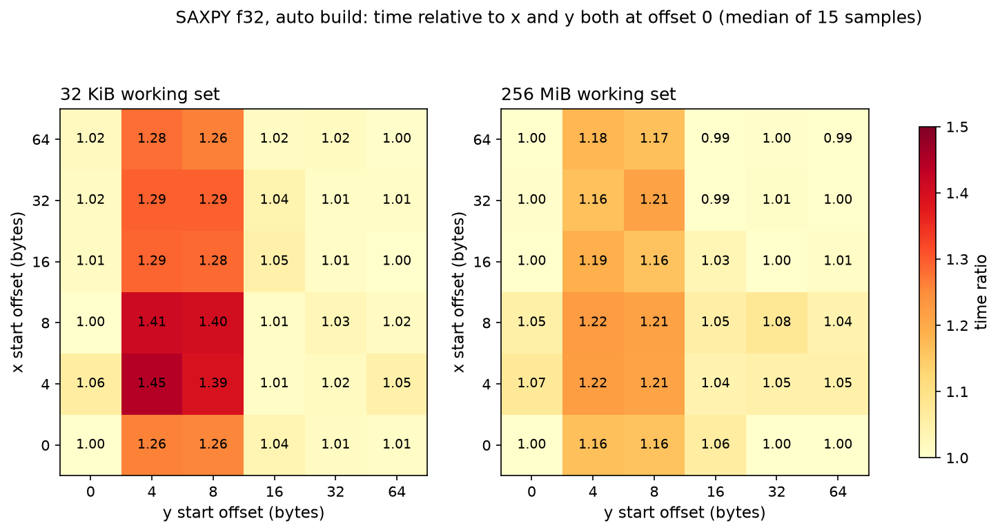

*Figure 7. Time ratio for independent x and y start offsets; look for the penalty in the y = 4 and y = 8 columns and none in the 16, 32, 64 columns or the x-only row (plots/exp12_relative_misalignment).*

Tails: 0.4 to 1.2 cycles per element for N up to 16, 0.35 at N = 32, 0.25 at N = 64 and 0.19 beyond N = 120. An affine fit over N = 32 to 160 gives, for f32 `auto`, 0.0258 ns per element plus a fixed cost of 2.2 ns (about 10 cycles); for f64 `auto` 0.0719 ns per element plus 1.2 ns; for the unrolled f32 loop 0.0859 ns per element plus 0.7 ns. Around N = 256, 1024 and 4096 no dependence on N modulo 4 or 16 rises above the roughly 1 ns noise (residual variation under 1.5 ns).

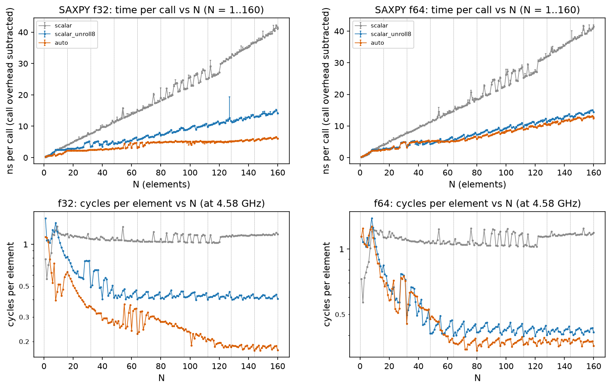

*Figure 8. SAXPY time per call (top) and cycles per element (bottom) for N = 1 to 160, f32 and f64; look for the fall toward 0.19 cycles per element and the irregular curve below N = 64 (plots/exp3_tail_small_n).*

**Explanation.** The alignment expectation failed: the penalty is 40% to 45% in L1, not under 5%. The penalty depends on each stream's offset modulo 16 B, not on their relative offset (x 4 B with y 8 B costs 1.39, x and y both 4 B costs 1.45, within 4%). Misaligned y costs most (1.26) and misaligned x little (1.06), but together they cost more than the sum (1.45): the vector loop loads and stores y and only loads x (vectorization section excerpt). Why 16 B misalignment is expensive is not established (hypothesis, not tested: accesses straddling a 16 B boundary are split, and stores are costlier to split than loads; test: load-only and store-only microbenchmarks at offsets 4 and 16, or counters). The scalar control is unaffected (at most 5.5%). For tails, the disassembly shows three code paths selected by compare-and-branch at entry (N below 4: scalar only; N below 16: the 4-element vector loop; otherwise the 16-element loop, then the 4-element loop, then a scalar loop), and the fixed cost of about 2.2 ns, about 10 cycles, matches that entry sequence plus the call. The expected sawtooth in N modulo 16 did not appear: epilogue iterations cost at most a few cycles, below the noise. The expected 3x to 10x per-element penalty below N = 64 is reached only below about N = 10 (0.4 to 1.2 against 0.19 cycles per element); between N = 32 and 63 it is 1.5x to 2x. Below N = 64 the curve is irregular, and no explanation is claimed.

**Implication.** Allocate vector data on 16 B boundaries (preferably line boundaries) and keep y, the stored array, aligned first; for short loops expect about 10 cycles of fixed cost and do not tune for remainders.

### 4.5 Stride and gather

**Question.** How fast does effective bandwidth fall as accesses become non-unit-stride or random, and does SIMD help?

**Expectation.** Useful bandwidth (bytes actually used) should fall to about 1/2 and 1/4 of unit stride at strides 2 and 4 beyond L1, because whole 128 B lines are fetched, and to 1/8 or lower at stride 8 and for a random gather. NEON has no gather or scatter, so `auto` should generate scalar code and match the unrolled scalar loop within 10%; forced vectorization should not help. Time per element should keep growing with stride up to 32 elements (one 128 B line), and the jump from stride 16 to 32 was expected to follow the line traffic (about 2x).

**Method.** f32 SAXPY with strides 1, 2, 4, 8, 16, 32 and a gather over 15 samples at footprints from 32 KiB to 512 MiB (Session B). Later probes added strides 24 and 48 and element counts that are or are not multiples of the 16 KiB page (Session D).

**Result.**

| f32 | stride 1 | 2 | 4 | 8 | 16 | 24 | 32 | 48 | gather |
|---|---|---|---|---|---|---|---|---|---|
| 512 MiB: ns per element | 0.075 | 0.200 | 0.298 | 0.552 | 1.17 | 1.42 | 11.5 | 3.96 | 2.94 |
| 512 MiB: useful GiB/s | 149 | 56 | 37.5 | 20.3 | 9.5 | 7.9 | 1.0 | 2.8 | 5.1 |
| fraction of unit-stride rate | 1 | 0.38 | 0.25 | 0.14 | 0.064 | 0.053 | 0.0065 | 0.019 | 0.034 |
| 32 KiB: ns per element | 0.042 | 0.167 | 0.166 | 0.171 | 0.227 | n/m | 0.375 | n/m | 0.136 |

*Table 9. Strided and gathered SAXPY, `auto` build, useful bytes counted (12 B per element, plus 4 B of index for the gather); n/m: not measured.*

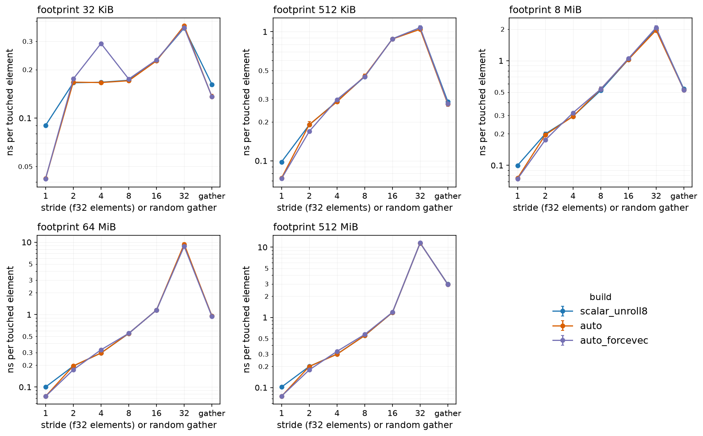

*Figure 9. Time per touched element versus stride at five footprints for the unrolled scalar, `auto` and forced-vector builds; look for growth with stride, a peak at stride 32 and a lower gather point (plots/exp4_stride_gather).*

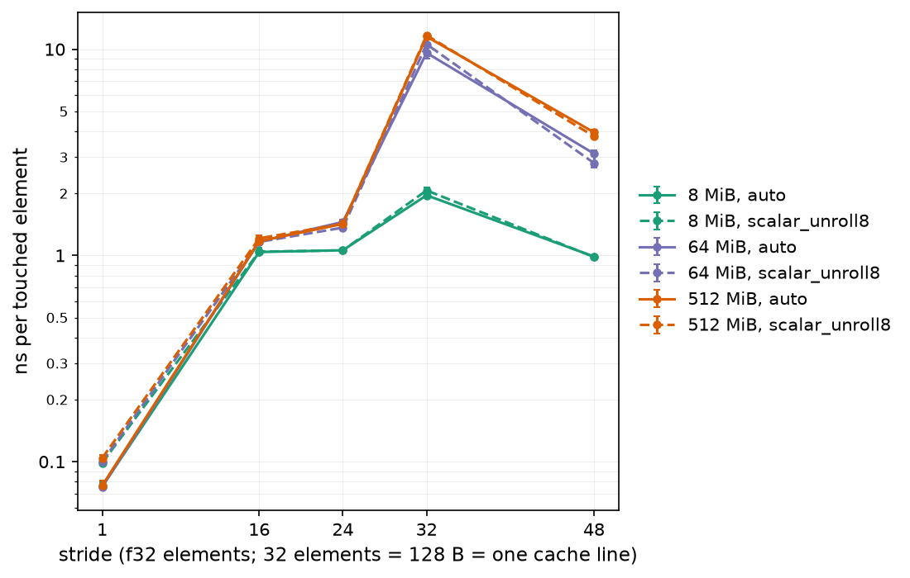

*Figure 10. Stride-jump probe at 8, 64 and 512 MiB; look for the peak at stride 32 and the partial recovery at 48 (plots/exp13_stride_jump).*

`auto` equals the unrolled scalar loop at every stride of 2 or more within 10% (the gather in L1 is 16% faster). Forced vectorization is not faster: 74% slower at stride 4 in L1, 11% faster at 512 MiB stride 2. At 32 KiB the cost per element is flat from stride 2 to 8 (0.17 ns) and then rises to 0.375 ns at stride 32.

**Explanation.** No SIMD gain is possible at strides of 2 or more because there is no cheap vector form: `auto` does not vectorize (Table 3), and the forced versions use `ld2`, `zip1` or lane inserts followed by lane stores. In DRAM, time per element roughly doubles per doubling of stride from stride 4 to 16 (0.298, 0.552, 1.17 ns), as expected when every element drags in a larger share of a 128 B line. The gather costs 2.94 ns per element, 39x unit stride; with a DRAM latency of 111 ns, 2.94 ns per element implies about 38 loads overlapping (derived from the two numbers; the overlap itself was not measured). The expectation for the stride-32 jump failed. Time per element rises 9.8x from stride 16 to 32 (1.17 to 11.5 ns) while line traffic per element only doubles, and it falls again to 3.96 ns at stride 48 (192 B) and rises only to 1.42 ns at stride 24; so it is not a threshold at one new line per access. A footprint that is a multiple of the 16 KiB page is not the cause: stride 32 with 2,097,152, 2,097,153 and 2,097,216 elements gives 11.52, 11.68 and 11.58 ns per element (within 1.4%). At 8 MiB (L2-resident) the same step is only 1.9x, so the effect appears beyond L2. The cause is unverified (hypothesis, not tested: an address-mapping or prefetch-training effect specific to a 128 B stride; test: a stride map at 20, 28, 36, 40, 56, 64, 96 and 128 elements and a shift of the x and y base addresses).

**Implication.** Strided and gathered access forfeits SIMD and most bandwidth; restructure data (structure-of-arrays, blocking) rather than hoping for vector gathers, and test power-of-two strides explicitly because they can be pathologically slow.

### 4.6 Traffic accounting and the memory ceiling

**Question.** What is the single-thread memory bandwidth ceiling, and does a simple STREAM-style triad under-report it because of write-allocate traffic (the read of a line that is about to be fully overwritten)?

**Expectation.** The single-thread triad should reach 60 to 120 GB/s, set by one core's outstanding-miss capacity. If write-allocate reads exist, SAXPY written out of place (`z = a*x + y`, the same three arrays as triad) should match triad within 5% and run at 0.75 to 0.85 of the in-place SAXPY rate (four line streams of real traffic for three counted). Counted bandwidth should rank read-only highest, then in-place patterns, then patterns with a write-only stream; adding one allocate read per write-only stream should bring all patterns within 10% of in-place SAXPY.

**Method.** Eight f32 patterns (read-only integer sum, in-place increment, copy, scale, add, triad, in-place SAXPY, out-of-place SAXPY) were timed at footprints from 32 KiB to 1 GiB (Session D). Convention: GiB/s of compulsory bytes (read 4, increment 8, copy 8, scale 8, add 12, triad 12, SAXPY 12, out-of-place SAXPY 12 per element), with no write-allocate fills counted. A second view adds 4 B per element for every array that is only written.

**Result.**

| footprint | read-only | increment | SAXPY in place | copy | scale | add | triad | SAXPY out of place |
|---|---|---|---|---|---|---|---|---|
| 4 MiB | 111.8 | 146.3 | 146.5 | 121.3 | 120.4 | 124.1 | 123.3 | 123.4 |
| 256 MiB | 81.5 | 131.2 | 146.5 | 116.2 | 117.6 | 121.3 | 117.4 | 121.7 |
| 1 GiB | 80.5 | 127.5 | 139.4 | 115.1 | 120.2 | 117.6 | 113.7 | 118.0 |

*Table 10. Counted bandwidth in GiB/s, `auto` build, Session D.*

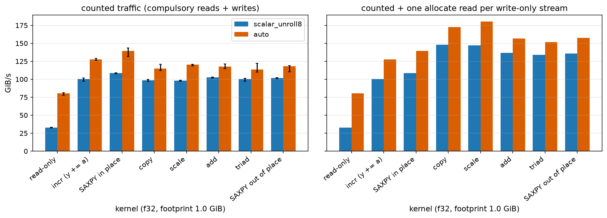

*Figure 11. Counted bandwidth by pattern at 1 GiB (left) and the same data with one allocate read added per write-only stream (right); look for the unequal bars on the right (plots/exp10_traffic_accounting).*

Single-process triad over 256 MiB to 2 GiB gave 121.8 to 123.4 GiB/s in Session C (131 GB/s). Out-of-place SAXPY is within 0.1% to 3.8% of triad and 0.83 to 0.85 of in-place SAXPY from 4 MiB to 1 GiB. With the allocate read added, triad is 9%, add 13% and out-of-place SAXPY 13% above in-place SAXPY at 1 GiB, but copy 24% and scale 29% above.

Reconciling the two in-place SAXPY values at 1 GiB. The locality sweep (Session A) gave 147.3 GiB/s and the traffic experiment (Session D) 139.4 GiB/s. The raw data show the same element count (134,217,728), the same two arrays, the same build and 15 or more samples in both, so size, array count and repetition count do not explain the difference. At 256 MiB the two sessions agree within 1.5% (148.7 and 146.5 GiB/s). Session A has a tight spread at 1 GiB (IQR 146.0 to 148.1, 30 samples); Session D has a wide one (IQR 132.0 to 143.5, minimum 102) and ran at higher background load (2.8 to 3.4 against 1.2 to 2.4). The likely cause is background load or memory-system state in Session D (hypothesis, not tested; test: alternate the two measurements within one quiet session). Convention adopted: the memory ceiling is 147 GiB/s from Session A, the quiet session with the tightest spread; ratios between patterns are used only within Session D, where out-of-place SAXPY is 0.83 to 0.85 of in-place SAXPY at every size, so the conclusions do not depend on the 5% offset.

**Explanation.** The triad expectation failed narrowly (131 GB/s against 60 to 120). In-place SAXPY reaches 147 GiB/s, so triad is not an upper bound; the highest rate of any pattern is the right ceiling. The numbers are consistent with, but do not show, write-allocate traffic: out-of-place SAXPY runs at 0.83 to 0.85 of the in-place rate (18% to 20% more time per element), between no penalty (ratio 1.0) and a full extra line stream (ratio 0.75, 33% more time). The ranking expectation also failed: read-only is the slowest pattern in DRAM (80.5 GiB/s against 114 to 139), and copy and scale are not below add and triad. Adjusting for allocate reads does not equalize patterns either (copy and scale end 24% and 29% above in-place SAXPY), so a simple extra-stream model is not supported. Why a single read stream is slowest is unknown (hypothesis, not tested: prefetch depth or concurrency depends on the number of streams; test: read-only loops over two and three arrays).

**Implication.** Quote a ceiling as the best sustained counted rate over several access patterns and state the byte-counting convention; a lone STREAM triad can understate what a core can do by 15% to 20%.

### 4.7 Roofline interpretation

**Question.** Given a measured bandwidth ceiling and an estimated compute peak, which kernels are memory bound and which compute bound, at each level of the hierarchy?

**Expectation.** The FMA peak should saturate with about 12 to 16 independent accumulators (latency times throughput) at 130 to 150 GFLOP/s for f32, with 80% to 90% sustained by code that is not a pure FMA stream. SAXPY and dot product should lie far left of the ridge and be memory bound beyond L2; in L1 they should be limited by load and store throughput, not the FLOP ceiling, and only the fast-math dot product should exceed 25% of the peak in L1.

**Method.** Peak: a loop of `fmla.4s` (f32) and `fmla.2d` (f64) with 1 to 30 independent accumulators, 15 repetitions each (Session C). Bandwidth: the traffic experiment above and multi-process triad runs with 1 to 12 concurrent processes (Session C). Arithmetic intensity uses compulsory bytes: SAXPY 2/12 = 0.167 FLOP/B, multiply 0.083, dot 0.25, stencil 0.625 (f32; half of each for f64).

**Result.**

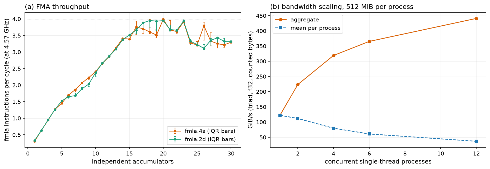

*Figure 12. (a) FMA instructions per cycle versus the number of independent accumulators; (b) triad bandwidth versus the number of concurrent single-thread processes; look for the maximum of 4 per cycle and the 441 GiB/s aggregate at 12 processes (plots/exp6_peaks).*

The f32 peak is 3.99 `fmla.4s` per cycle at 20 accumulators, 8 FLOP each: 3.99 x 8 x 4.57 GHz = 145.8 GFLOP/s (IQR 145.7 to 146.9); f64 is 72.3 GFLOP/s. Throughput passes 3 per cycle at 14 accumulators but reaches 4.0 only at 20, 23 and 26; the median over 12 to 30 accumulators is 3.4 per cycle (85% of the maximum). Four floating-point pipes are inferred. The ridge is 145.8 GFLOP/s divided by 147 GiB/s (158 GB/s), 0.92 FLOP/B (1.11 with the lower triad ceiling). Aggregate triad bandwidth with 1, 2, 4, 6 and 12 processes is 122, 224, 319, 365 and 441 GiB/s; per-process rates become bimodal at 12 processes (68 to 76 against 27 to 32 GiB/s).

| kernel (f32, `auto`) | AI (FLOP/B) | GFLOP/s L1 / DRAM | % of peak L1 / DRAM | % of memory ceiling, DRAM |
|---|---|---|---|---|
| SAXPY | 0.167 | 46.6 / 26.4 | 32 / 18 | 100 |
| multiply | 0.083 | 23.1 / 10.8 | 16 / 7 | 82 |
| dot, strict | 0.25 | 4.4 / 4.2 | 3 / 3 | 11 |
| dot, fast-math | 0.25 | 40.8 / 28.8 | 28 / 20 | 73 |
| stencil | 0.625 | 83.7 / 71.4 | 57 / 49 | 72 |

*Table 11. Roofline coordinates (L1: 32 KiB, DRAM: 1 GiB working set).*

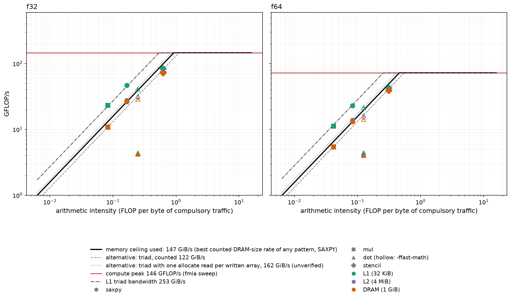

*Figure 13. Single-thread roofline for f32 (left) and f64 (right) with the memory ceiling used (solid), alternatives, compute peak and working-set regimes; look for all points left of the ridge and the strict dot product far below the slope (plots/exp6_roofline).*

**Explanation.** Every kernel lies left of the ridge, so DRAM-size performance is set by bandwidth: SAXPY defines the ceiling (100%), multiply and the stencil reach 82% and 72% of it, and fast-math dot 73%. In L1, SAXPY and multiply sit at 103% and 102% of the L1 bandwidth slope (253 GiB/s from an L1-sized triad) while using only 32% and 16% of the FMA peak: they are bound by load and store throughput, as expected. The stencil reaches 57% of the peak in L1 without touching a roof; its instruction mix (3 vector arithmetic operations plus shuffles per 4 outputs) is the likely limit (hypothesis, not tested: instruction issue; test: count instructions per output against measured cycles). The strict dot product is neither compute nor memory bound: at 3% of peak and 11% of the memory ceiling it is latency bound (see the dot-product section). No kernel is compute bound. The expectation of saturation at 12 to 16 accumulators held only partly (3 per cycle at 14, 4 at 20). A single-accumulator `fmla.4s` chain shows 6.2 cycles of latency against about 4 with more accumulators, and the throughput is non-monotonic in the accumulator count; both are unexplained.

**Implication.** Under this roofline, optimizing arithmetic does nothing for SAXPY, multiply or the stencil beyond L1; reduce bytes per FLOP or exploit more cores, and treat the strict reduction as a latency problem.

### 4.8 Negative cases

**Question.** When does code that looks SIMD-friendly fail to benefit, and can each failure be verified and explained from compiler output and timings?

**Expectation.** A float reduction without fast-math should either not vectorize or run at scalar speed, and fast-math should recover 2x to 4x. A perfectly vectorized SAXPY beyond the last-level cache should gain only 1.0x to 1.3x. Without `restrict`, the compiler should add a runtime overlap check costing under 10% for disjoint arrays but costing more below N = 64, and an overlap of one element should send execution to a slow scalar path (4 to 6 cycles per element).

**Method.** Compiler remarks and disassembly for each build (Table 3); timings from the sweeps; dot-product accuracy against a double-double reference for N = 1e3 to 1e8; aliasing runs with y = x, x + 1 and x + 64 elements at 32 KiB, 4 MiB and 256 MiB; the cost of the check for N = 4 to 4096 (Session C).

**Result and explanation.**

(A) Reduction: looks SIMD-friendly, but only the multiply is vectorized. At plain `-O3` the f32 dot product is reported as vectorized (width 4, interleave 4), but the loop body is `fmul.4s` followed by 16 serial scalar `fadd`s, because a strictly ordered sum cannot be reassociated. The measured effect is 1.46x over unrolled scalar at every working set and about 2.1 cycles per element, a dependence-chain limit (see the dot-product section). Fast-math reassociates into 16 partial sums and gains 10x to 14x. Numerically, the in-order f32 sum has error 3.3, 86, 139, 1.3e5 and 1.1e7 times epsilon at N = 1e3, 1e5, 1e6, 1e7 and 1e8, because additions of terms near 1 are absorbed once the running sum exceeds 2^24; the fast-math result has error 0.5, 1.8, 2.0, 9.4 and 3.8e3 times epsilon, so the faster build is also the more accurate here. The two differ by up to 1e-2 relative at 1e7. The default scalar and `auto` strict results differ slightly (139 against 137 epsilon at N = 1e6) because the scalar build uses fused `fmadd` while `auto` uses a separate multiply and add.

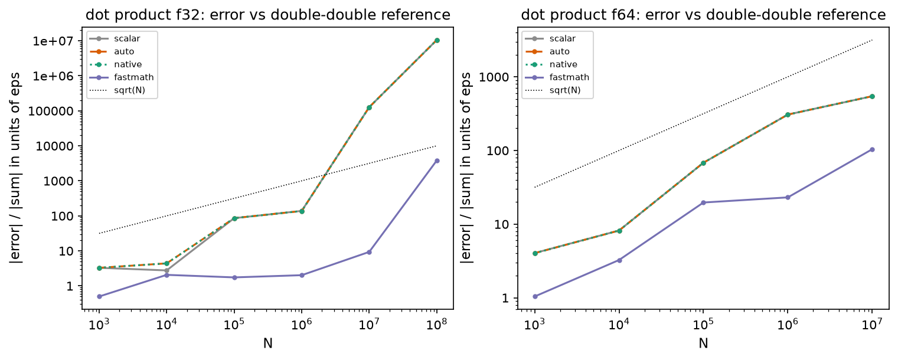

*Figure 14. Dot-product error against a double-double reference in units of machine epsilon, with the sqrt(N) line; look for the strict sum growing faster than sqrt(N) and fast-math staying lowest (plots/exp7_reduction_accuracy).*

(B) Fully vectorized but memory bound. f32 SAXPY at 1 GiB compiles to the 12-instruction loop of the vectorization section (16 elements per iteration) and is only 1.35x faster than the unrolled scalar loop, because the vector loop is limited by the same core-side ceiling (147 GiB/s), which the scalar loop already reaches at 109 GiB/s, 74% of the vector rate (see the locality section).

(C) Aliasing. Without `restrict` the compiler emits the runtime overlap check and a scalar fallback (Table 3). For disjoint arrays the check costs under 7% at large N and 0% to 2% for N = 8 to 1024, but 43% at N = 4 (a fixed cost that dominates a tiny loop). If y = x + 1 the check fails, the scalar loop runs with a loop-carried dependence through memory, and the time is 9.4 to 12.8 cycles per element, 28x to 67x slower than the 0.19 to 0.34 cycles of vector code and above the expected 4 to 6 (hypothesis, not tested: store-to-load forwarding latency in the dependent chain; test: vary the overlap distance). At y = x + 64 the scalar path runs at 1.0 cycle per element. Results remain correct in all cases (an overlap test confirms the sequential result).

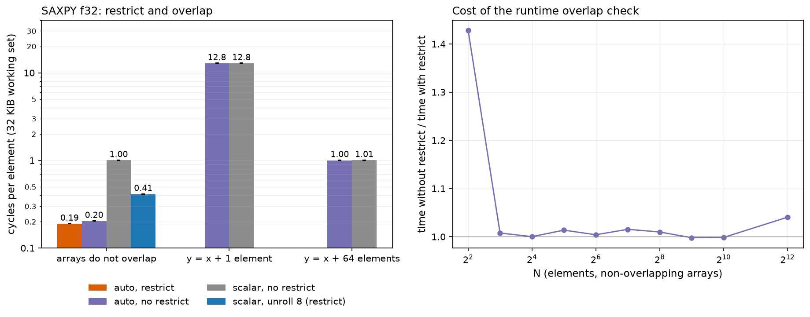

*Figure 15. Cycles per element at 32 KiB for disjoint and overlapping arguments (left, values on bars) and the cost of the runtime check for small N (right); look for 12.8 cycles per element when y = x + 1 (plots/exp7_alias_restrict).*

Which case is which. Case (A), and the overlap fallback in (C), satisfy "looks SIMD-friendly but is not (effectively) vectorized": the multiply of the dot product is vectorized but the reduction is not, and the aliased loop runs scalar code at run time. The strided SAXPY and gather of the stride and gather section are a clean instance of loops that are not vectorized at all. Case (B) satisfies "vectorized but memory bound".

**Implication.** Check the loop body, not only the vectorization remark; give the compiler `restrict` on parameters; write reductions with explicit independent accumulators or allow reassociation deliberately.

### 4.9 The naive benchmark

**Question.** Would a plausible but careless benchmark have produced believable numbers, and how would the flaws have been caught?

**Expectation.** A loop whose result is never used should be removed or hoisted (unphysical time); reads of never-written calloc memory might hit the shared zero page and look cache-resident; first-touch page faults in the timed region should understate bandwidth. The corrected benchmark should differ by more than 3x in at least one case.

**Method.** A deliberately naive benchmark was written first, with a corrected twin; both datasets were kept (5 runs per variant).

**Result and explanation.**

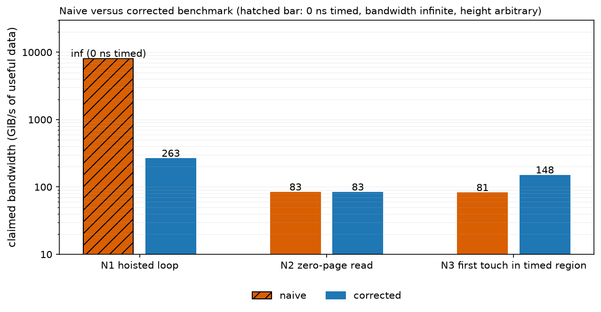

*Figure 16. Bandwidth claimed by the naive benchmarks and by their corrected versions, log scale; the hatched bar is infinite (0 ns timed) with arbitrary height; look for the infinite N1 bar and the 1.8x gap in N3 (plots/exp8_naive_vs_fixed).*

N1: a multiply loop in the timing function with no consumer measured 0 ns, which is reported as infinite bandwidth; the assembly of the timed region contains no loop. Corrected, it gives 263 GiB/s, in line with the main harness. N3: first touch inside the timed region gave 81 against 148 GiB/s (1.8x too low), because page faults were being timed. N2: reads of a calloc array did not show the predicted artifact (83 against 83 GiB/s); the naive variant had a warm-up pass that faults pages in, so this does not prove the artifact cannot occur (the variant without warm-up was not tested). The first "corrected" N2 still measured 0 ns in every run: a plain memory-clobber barrier does not stop the compiler from hoisting calls on memory that never escaped, and the pointer has to be passed to the asm statement itself; this was detected because the variant labelled correct printed infinite bandwidth. Both datasets are kept. Four flaws in the main harness were found and fixed the same way (from disassembly or implausible numbers): `restrict` on local pointers, a non-unrolled scalar baseline, the 64-bit `long double`, and an overridden `-Rpass` option.

**Implication.** Treat any result that is infinite, faster than L1 allows or insensitive to size as a harness bug until the assembly of the timed region has been read.

## 5. Discussion

The experiments tell one story. The advertised SIMD gain depends first on the baseline: the default scalar loop leaves 2.5x on the table, and against an unrolled loop f32 SAXPY gains 2.1x in L1, not 4x. Past the 128 KiB L1 boundary the gain falls to 1.35x not because the hierarchy steps down (it does, by a factor of about 170 in latency) but because a core-side limit of about 35 counted bytes per cycle caps both vector and scalar loops; the pointer chase and the multi-process scaling together exclude a latency or DRAM limit, while the in-core mechanism stays open. Instruction-level parallelism and SIMD are separate resources: the dot product's 14x gain is 8.4x independent accumulators and 1.7x SIMD, and in f64 SIMD adds nothing. Access pattern is the dominant cost once data leave L1: a 4 B misalignment of y costs 26%, a stride of 32 elements costs 10x per element, a gather 39x. The roofline places every kernel on the memory slope in DRAM and on the load/store slope in L1, with the strict reduction latency bound; arithmetic optimization is not where these kernels have headroom.

| topic | expected | observed | verdict |
|---|---|---|---|
| SIMD gain in L1 over unrolled scalar | f32 2.5x to 4x, f64 1.5x to 2x | f32 2.1x (SAXPY), 2.2x (multiply), 2.9x (stencil); f64 1.07x; 5.2x over the default scalar build | partly matched |
| Where gain compresses | at L2 and DRAM | at the L1 boundary (2.08x to 1.37x); nothing at L2 or DRAM | not matched |
| f64 against f32 | f64 about half | f64 SAXPY 1.07x against 2.08x; u32 like f32 | partly matched |
| f32 dot product | not vectorized; fast-math 2x to 4x | vectorized, serial sum, 1.46x; fast-math 13.6x | not matched |
| Pointer-chase latency | 3 to 4 cycles L1; 12 to 20 cycles L2; SLC step; 90 to 140 ns DRAM | 3.0 cycles; 12 then 32 to 43 cycles; no SLC plateau; 111 ns; unexpected step near 1 MiB, not a TLB effect | partly matched |
| Bandwidth plateau | steps at each level; fixed miss limit possible | flat 147 to 154 GiB/s; lines in flight grow 14x; core-side limit inferred | not matched (explained) |
| Dot decomposition | chain break 4x to 6x, SIMD 2.3x to 3.5x | 8.4x and 1.7x (f64 SIMD 0.8x to 1.0x) | not matched |
| Alignment | under 5% | up to 45%; per stream, y worst, not relative offset | not matched |
| Tails | 3x to 10x below N = 64; mod-16 sawtooth | 2x to 6x below N = 16; fixed cost 2.2 ns; no sawtooth | partly matched |
| Stride and gather | 1/2, 1/4, 1/8 of bandwidth; SIMD 1.0x; line-threshold jump | matched except stride 32: 10x spike, recovers at 48 | partly matched |
| Single-thread memory ceiling | triad 60 to 120 GB/s; write-allocate explains triad | triad 131 GB/s; SAXPY 147 GiB/s higher; write-allocate not shown | not matched |
| FMA peak | 130 to 150 GFLOP/s; saturation at 12 to 16 accumulators | 145.8 GFLOP/s; 4.0 per cycle only at 20 or more | partly matched |
| Roofline | memory bound in DRAM; load/store bound in L1 | as expected for all four kernels | matched |
| Negative cases, naive benchmark | reduction not vectorized; overlap slow; naive errors over 3x | reduction vectorized but serial (1.46x); 28x to 67x slower on overlap; N1 infinite, N3 1.8x, N2 absent | partly matched |

*Table 12. Expectations against outcomes.*

Practical recommendations.

- Choose the baseline deliberately: report speedup against an unrolled scalar loop and against the default build, with cycles per element, and check that the default build is not loop-overhead bound.
- Expect large SIMD gains only when the scalar loop leaves load/store or arithmetic capacity idle and data are in L1; beyond L1 expect 1.0x to 1.4x for streaming loops and plan for the core-side bandwidth ceiling.
- Verify vectorization from the loop body and the remarks together (look for `fmla.4s`, `ldp q`, and for serial `fadd` in reductions); a "vectorized" remark alone is not proof.
- Handle reductions with several independent accumulators (8 to 16) before reaching for fast-math, and keep the in-order sum only where bit-exact results matter.
- Align stored arrays to 16 B or more, avoid strides of 2 or more and gathers in hot loops, and test power-of-two strides explicitly.
- Put `restrict` on kernel parameters, not on locals.
- Benchmark honestly: first-touch data outside the timer, pass pointers into an asm barrier, read the assembly of the timed region, report spread, and treat infinite or L1-exceeding numbers as bugs.

## 6. Limitations and unexplained results

- No hardware counters. All mechanism claims rest on disassembly, cycle counts and timing, and are labelled where untested. A counter-capable platform would settle instruction mix, cache misses and split accesses.
- No core pinning. The thread migrated among the six Super cores (10% to 35% residency each); migration keeps the shared L2 but not L1 contents, and its effect was not isolated. Placement was verified for one benchmark only. A pinned or migration-free run would test this.
- Estimated frequency. The clock comes from a one-cycle-add assumption and varies by about 1%; Session D is 0.8% below Sessions A to C. Cycles per element assume it is constant; logging frequency throughout a run would remove the assumption.
- Short sessions and thermal state. Sessions lasted 10 to 20 minutes and thermal pressure was only a coarse level, so sustained throttling is untested; a 30-minute loop would test it. Background load was 1.2 to 3.4 and not controlled by the harness.
- Single machine and Apple-specific design. Unified memory, 16 KiB pages and 128 B lines may not generalize; the alignment penalty, the flat bandwidth and the stride-32 spike in particular could differ on x86 or other Arm cores. No second host was available.
- Session difference at 1 GiB. In-place SAXPY gave 147.3 and 139.4 GiB/s in two sessions (see the traffic section); the hypothesis is background load; a repeat in one quiet session would test it.
- Unexplained, with the hypothesis and test: the latency step near 1 MiB (an unreported cache level or L2 capacity effect; chases with varied stride and alignment); the 15 ns page-granular latency after 1024 lines (L1 miss plus TLB; vary page count at fixed line count); the stride-32 spike (address mapping or prefetch training; stride map and base-address shifts); the mechanism and asymmetry of the misalignment penalty (split accesses, stores costlier; load-only and store-only loops); the slow read-only stream (prefetch depth per stream; multi-array read loops); the single-accumulator `fmla.4s` latency of 6.2 cycles and non-monotonic FMA throughput (scheduling or register effects; instruction-level microbenchmarks); the dip at 16 to 32 KiB in the SAXPY curve (no hypothesis); the in-core cause of the 147 GiB/s plateau (L1 fill or store rate; load-only and store-only streaming loops).

## 7. AI-use note

- Tool: Claude Code (Anthropic's command-line coding agent) worked in the repository from task descriptions written by the student, and executed all builds and benchmarks on the student's machine.
- Generated by the tool: the benchmark harness, kernels, correctness tests, FMA-peak and accuracy tools, plotting and analysis scripts, the compiler-output reports, the experiment designs and expectations (sizes, strides, offsets, thresholds and predicted values), the naive-benchmark demonstration, and the drafts of this report.
- Found and corrected by the tool's own checks, each of which changed the method: `restrict` on local pointers (runtime overlap checks stayed in the assembly); a non-unrolled default scalar baseline that inflated early speedups to about 5x; a 64-bit `long double` (replaced by a double-double reference); a `-Rpass` option that overrode the earlier one (empty first remark files); a first "corrected" naive benchmark that still timed 0 ns; register-level stencil annotations that had not been traced (removed). The expectation that the 1 MiB latency step was a TLB effect was tested and refuted. A build that had been left broken by an unfinished edit was completed and tested before any data were collected. The clock estimate was cross-checked with a multiply chain and with power sampling; tolerances were checked by mutation.
- Where expectations were wrong (alignment, the compression point, the dot product, an SLC step, read-only bandwidth, the stride-32 jump), the outcomes are reported as such in Table 12.
- Student contributions recorded: three power-sampling runs taken after Sessions A to C and used in the setup section, re-running of the benchmarks, spot-checking of report numbers against the data, and closing a virtual machine and a torrent client before Session D.
- Hand modifications of the generated code or text and any code contributed by other team members are not recorded in the work history and are therefore not claimed here.

## Appendix: data and code

Layout. `src/` holds the kernel template, harness and the naive benchmark; `tests/` the correctness suites; `scripts/` build, experiment, plotting and PDF scripts (`scripts/config.sh` has the flags of every build); `data/raw/` one CSV per run and `data/processed/` derived tables; `plots/` the figures (PNG and PDF); `vecreports/` compiler remarks and disassembly; `report/` this document.

Commands (from `Project-1/`; macOS on Apple Silicon, Apple clang, Python 3 with numpy and matplotlib; AC power, Low Power Mode off, no heavy background load when measuring):

```
scripts/run_tests.sh                  # build and run the correctness suites (about 1 minute)
scripts/run_all.sh                    # build, test, vectorization reports, all plots from the supplied data (about 1 minute)
COLLECT=quick scripts/run_all.sh      # also re-measure a reduced version of every experiment (about 2 minutes here)
COLLECT=full  scripts/run_all.sh      # full re-measurement (about 1 hour; 8 GB free memory for the 2 GiB sets)
python3 scripts/make_report_pdf.py    # rebuild the PDF (needs: pip install markdown, and Google Chrome)
```

A fresh copy of the repository reproduced every processed table byte for byte from the supplied raw data, and the quick re-measurement agreed with the full run (f32 SAXPY speedup in L1 2.10x against 2.08x; FMA peak 146.0 against 145.8 GFLOP/s; triad 120.6 to 123.2 against 121.8 to 123.4 GiB/s; chase latency 0.65 and 110.3 ns against 0.66 and 110.8 ns; stride 32 at 512 MiB 11.5 ns in both). Deviation: `copy` at 256 MiB was 82.7 GiB/s in the quick run against 116.2 in the full run (one pass of 3 samples).

File names carry the run label of each session: Session A `phase3`, B `phase4`, C `phase5`, D `ext1`. Plot names are under `plots/`, processed tables under `data/processed/`, raw CSVs under `data/raw/`, compiler outputs under `vecreports/`.

| claim or figure | plot | processed table | raw data | compiler evidence |
|---|---|---|---|---|
| Speedups, rates, Tables 4 and 5, Figures 1 to 3 | exp1_sweep_f32, exp1_sweep_f64, exp5_dtype | exp1_key_table_phase3.csv | sweep_phase3_A..D.csv | summary.md, asm/scalar_saxpy_f32.s |
| Locality, Figure 4 | exp2_saxpy_locality | exp1_speedup_phase3.csv | sweep_phase3_D.csv | asm/auto_saxpy_f32.s |
| Chase, Table 6, Figure 5 | exp9_chase_latency | extra_chase_ext1.csv, extra_chasepage_ext1.csv | chase_ext1.csv, chasepage_ext1.csv | none |
| Vectorization, Table 3 | none | none | none | remarks/auto_saxpy_f32.txt, remarks/auto_saxpy_s2_f32.txt, asm/auto_saxpy_f32.s |
| Dot, Table 7, Figure 6 | exp11_dot_decomposition | extra_dot_decomposition_ext1.csv | dotdec_ext1.csv | asm/auto_dot_f32.s |
| Alignment, Table 8, Figure 7 | exp12_relative_misalignment, exp3_alignment | extra_misalign_ext1.csv, phase4_summary_phase4.txt | misalign_ext1.csv, align_phase4.csv | none |
| Tails, Figure 8 | exp3_tail_small_n, exp3_tail_mod16 | phase4_summary_phase4.txt | tail_phase4.csv | asm/auto_saxpy_f32.s |
| Stride, Table 9, Figures 9, 10 | exp4_stride_gather, exp13_stride_jump | phase4_summary_phase4.txt, extra_summary_ext1.txt | stride_phase4.csv, stridejump_ext1.csv | remarks/auto_saxpy_s2_f32.txt |
| Traffic, Table 10, Figure 11 | exp10_traffic_accounting | extra_traffic_ext1.csv | ceiling_ext1.csv | none |
| Roofline, Table 11, Figures 12, 13 | exp6_peaks, exp6_roofline | roofline_points_phase5.csv, phase5_summary_phase5.txt | fmapeak_phase5.csv, triad_phase5.csv, triadmp_phase5_*.csv | none |
| Reduction, Figure 14 | exp7_reduction_accuracy | phase5_summary_phase5.txt | accuracy_phase5.csv | asm/auto_dot_f32.s |
| Aliasing, Figure 15 | exp7_alias_restrict | phase5_summary_phase5.txt | alias_phase5*.csv, restrict_smalln_phase5.csv | asm/auto_norestrict_saxpy_f32.s |
| Naive benchmark, Figure 16 | exp8_naive_vs_fixed | phase5_summary_phase5.txt | naive_phase5.csv, naive_phase5_run1_fix_still_hoisted.csv | naive/n1_naive_timed_region.txt |
| Clock, placement | none | extra_summary_ext1.txt | freq_phase3.csv, freq_ext1.csv, powermetrics_*_20261006.txt | none |

*Table 13. Evidence index.*
