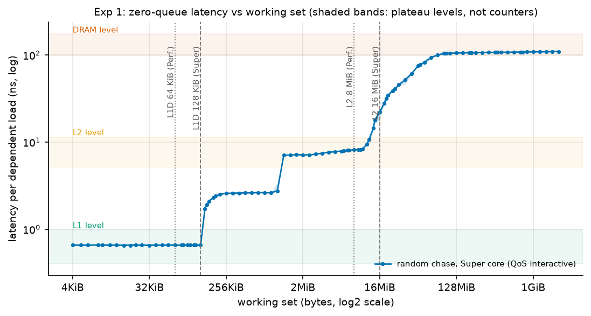
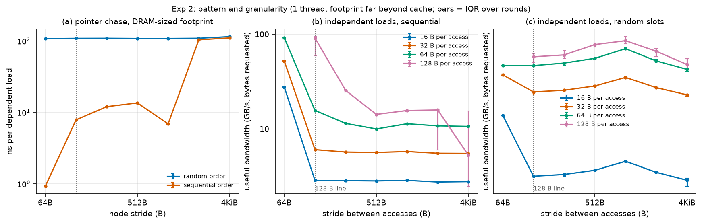
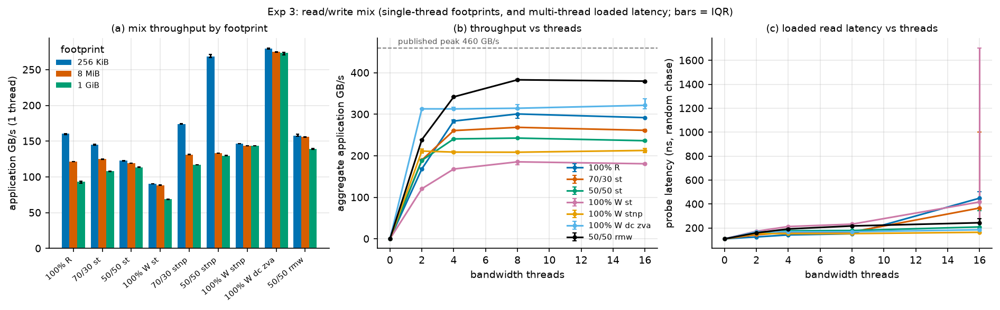
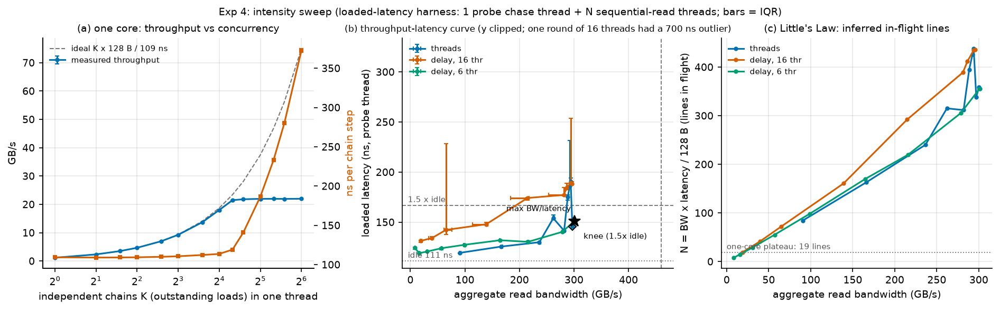
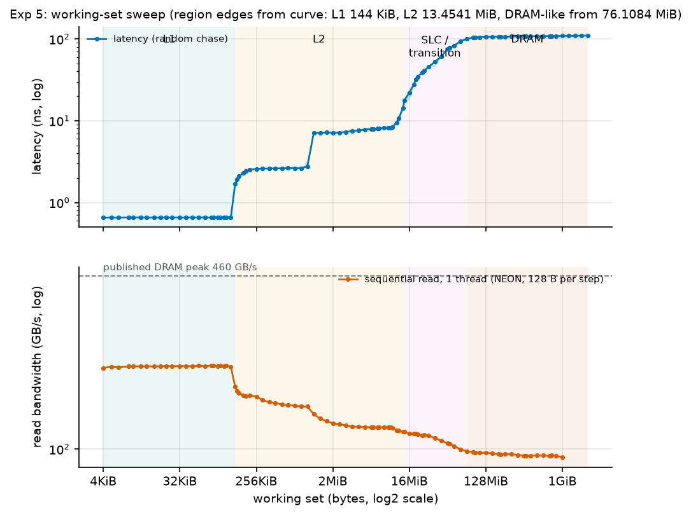
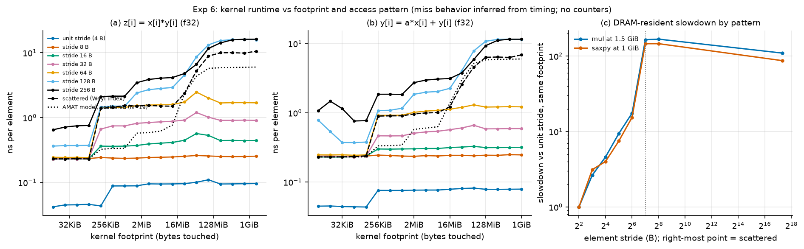
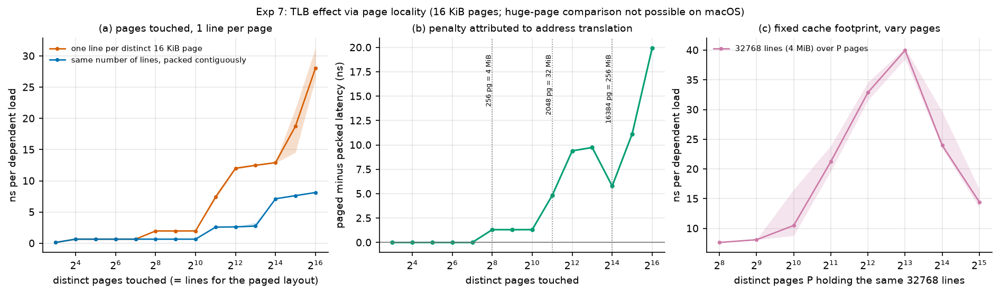
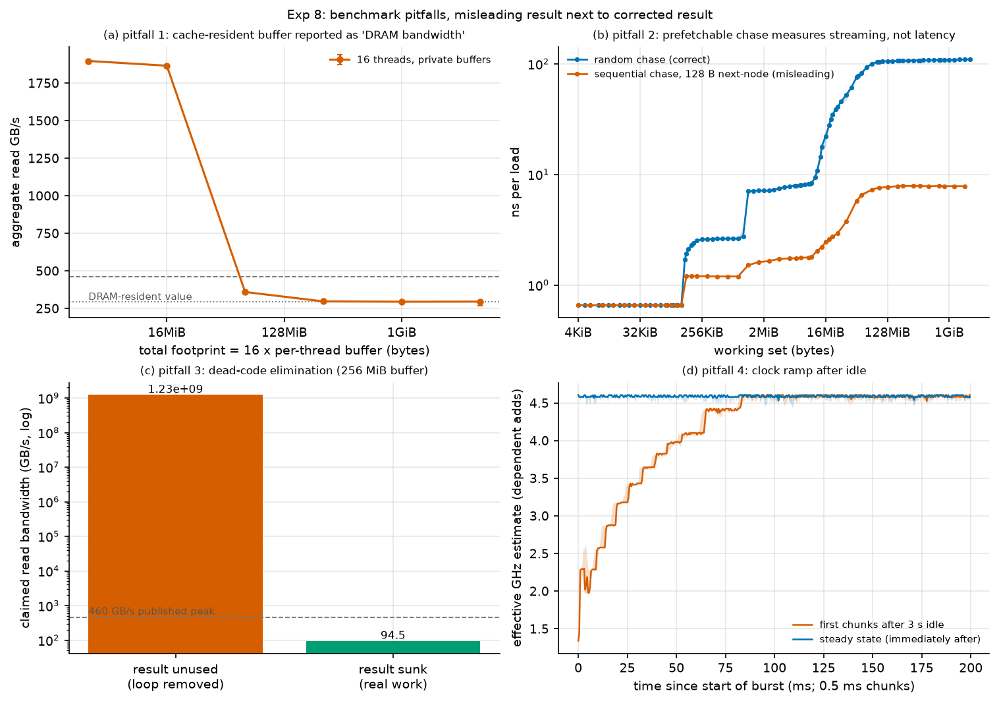

# Cache and memory performance profiling on an Apple M5 Max

ECSE 4320/6320, Class-wide Project 2. Data: session `20261014-0029` (full profile, 4 to 9 shuffled rounds per point). Hypotheses were committed before any benchmark code or data (`hypotheses.md`, commits `f984f0d`, `74271ca`, `8fd3520` in order). All plots show medians with IQR bands or bars over rounds. Cycle values use an estimated 4.58 GHz (dependent-add calibration, stable within 1% start to end); every cycle number is an estimate.

## 1. Results at a glance

| Quantity (one Super core unless stated) | Measured |
|---|---|
| L1 hit latency | 0.66 ns, about 3 cycles |
| L2 latency | 7.6 ns, about 35 cycles (plateau from 1.2 MiB to about 13 MiB); a 2.6 ns plateau exists from 144 KiB to 1 MiB |
| System-level cache region | a latency ramp from 13.5 MiB to 76 MiB (90 ns at 64 MiB); no plateau, size not identifiable |
| DRAM latency | 109 ns, about 500 cycles (loaded harness with 0 bandwidth threads: 111 ns) |
| Single-core DRAM read bandwidth | 93 GB/s sequential (NEON); 22 GB/s from independent random lines |
| Concurrency limit per core for demand misses | 18.8 lines in flight (Little's Law, Section 3.4) |
| Chip-level read bandwidth | 301 GB/s (66% of the published 460 GB/s) with 6 threads; no gain from more threads |
| Knee | 6 streaming threads, 301 GB/s at 151 ns (1.35x idle); 16 threads add only latency (about 1.7x idle) |
| Largest bandwidth observed | 380 GB/s (83% of 460) for a read-modify-write mix, so read-only 301 GB/s is not the DRAM limit |
| TLB | first penalty at 256 pages (4 MiB reach, +1.3 ns), large penalty from 2048 pages (+4.8 ns), +20 ns at 65536 pages |
| Clock after 3 s idle | 1.3 GHz at burst start, 3.2 GHz at 20 ms, 4.58 GHz after 100 ms |

## 2. Method in brief

Own benchmarks in C (`src/membench.c`, Apple clang 21.0.0, `-O2 -mcpu=native -ffp-contract=off`). Latency: one randomly permuted single-cycle chain with one node per 128 B line, 8-way unrolled dependent loads, timed regions of at least 25 ms, a warm pass first, a new permutation each round. Bandwidth: NEON kernels with independent accumulators, 128 B per step, plus independent-load kernels for stride and granularity. Loaded latency: one probe thread chasing a 1 GiB chain while N threads stream sequentially over private 256 MiB buffers, with an optional injection delay. Every worker sets `QOS_CLASS_USER_INTERACTIVE` inside its own thread. Metadata (hardware, OS, compiler, flags, thermal, load, frequency, protocol) is saved in `data/raw/meta_*.json`; deviations from the assignment are in `README.md`.

Placement check (pinning is unavailable): a `QOS_CLASS_USER_INTERACTIVE` thread keeps 96 KiB in L1 (0.66 ns) and has a 10.8 ns latency at 12 MiB (inside L2); a `background` thread shows 13.4 ns at 96 KiB and 138 ns at 12 MiB. The first signature matches the Super core (L1D 128 KiB, L2 16 MiB), the second a Performance core (64 KiB, 8 MiB). Placement is therefore observed, not guaranteed, for the main runs. In the multi-thread runs more than 6 threads necessarily include Performance cores (6 Super cores exist); the per-thread rate spread (43 to 61 GB/s at 6 threads, 30 to 44 at 8) shows the mix.

No hardware cache or TLB counters were available (Section 7); miss behavior is inferred from timing.

## 3. Experiments

### 3.1 Zero-queue baselines (Exp 1)

| Level | Working set | ns median (IQR) | Cycles (est.) |
|---|---|---|---|
| L1 | 32 KiB | 0.66 (0.65 to 0.66) | 3 |
| L2 | 4 MiB | 7.64 (7.63 to 7.66) | 35 |
| L2, near capacity | 12 MiB | 10.76 (9.53 to 10.97) | 49 |
| SLC region | 64 MiB | 93.8 (89.7 to 94.3) | 430 |
| DRAM | 1 GiB | 109.0 (109.0 to 109.5) | 500 |

Caveats: the SLC size is not exposed, so the 64 MiB value is a point on a ramp, not a level. The 1 GiB value includes TLB misses (Section 3.7), so it is slightly above a TLB-hit DRAM latency. A chase over a 2 GiB sweep is single-threaded and idle-system; a loaded machine will show higher values. Repeatability is high (IQR/median 0.4% to 0.5% at the plateaus).

### 3.2 Pattern and granularity (Exp 2)

Pointer chase, 1 Mi distinct lines (strides 64 B to 4 KiB; footprint 128 MiB of lines or more, so large strides do not shrink the cached footprint). Random order: 108 to 115 ns for every stride. Sequential order: 7.8 ns at 128 B (14x faster than random), 12.0 and 13.6 ns at 256 and 512 B, 6.9 ns at 1 KiB, and 104 and 110 ns at 2 and 4 KiB. The prefetcher therefore tracks constant strides up to 1 KiB and not beyond. The 64 B stride sequential chase reads 0.9 ns because two nodes share each 128 B line.

Independent loads (useful GB/s, bytes requested): sequential full-line streaming (128 B at stride 128 B) reaches 91 GB/s, but 16 B accesses at 128 B stride reach only 2.9 GB/s, which is a line rate of about 23 GB/s, the same limit as 19 outstanding demand misses at 109 ns (Section 3.4). Granularity matters: at stride 128 B the line rate is 23 (16 B accesses), 24 (32 B), 31 (64 B) and 91 GB/s (128 B). Random slots are limited to 2.8 GB/s (16 B), 7.0 GB/s (64 B) and 7.6 GB/s (128 B) at stride 128 B, so a random 128 B access reaches only a third of the line rate of a random 16 B access (unexplained, Section 6).

### 3.3 Read/write mix (Exp 3)

Single thread, 1 GiB footprint (application bytes, IQR in `data/processed/tables.md`):

| Mix | GB/s | Modeled DRAM GB/s (write-allocate model) |
|---|---|---|
| 100% read | 93.4 | 93.4 |
| 70/30, plain stores | 108.1 | 140.6 |
| 50/50, plain stores | 113.5 | 170.3 |
| 100% write, plain stores | 68.7 | 137.3 |
| 70/30, `stnp` | 116.8 | 116.8 |
| 50/50, `stnp` | 129.8 | 129.8 |
| 100% write, `stnp` | 143.6 | 143.6 |
| 100% write, `dc zva` | 273.3 | not established |
| 50/50 read-modify-write (same lines) | 139.0 | 139.0 |

Write-allocate shows in the pair (plain 68.7 GB/s, `stnp` 143.6 GB/s): the non-temporal variant doubles application throughput, matching a plain store moving twice the bytes (read for ownership plus write-back, factor 2.0 in the model). The traffic factors are a model; no DRAM counter confirms them. The `stnp` hint is therefore honored and changes throughput by 109%. `dc zva` (zero a 64 B block without reading) reaches 273 GB/s from one core, which is 2.9x the read rate, 4.0x plain stores, and close to the 6-thread read rate. This number is not trusted as DRAM write bandwidth: zero lines may be absorbed by the SLC or compressed before reaching DRAM, and the experiment cannot tell.

Multi-thread (probe thread plus N streaming threads): read-only saturates at 301 GB/s; 100% writes with plain stores saturate at about 180 GB/s and raise the probe latency to 1.9x idle at 4 threads and 3.8x at 16; `stnp` and `dc zva` writes reach 213 and 322 GB/s; the read-modify-write mix reaches 380 GB/s. Read-only is therefore limited by something other than DRAM peak (Section 6). A write-heavy plain-store mix raises loaded read latency more than a read-only mix at equal thread count (1.93x vs 1.30x at 4 threads), but it also moves different traffic, so this is not an equal-rate comparison.

### 3.4 Intensity sweep, knee, Little's Law (Exp 4)

One core, K independent random chains (Little's Law, N = throughput x L0 / 128 B with L0 = 109 ns, the K = 1 latency):

| K | 1 | 4 | 8 | 16 | 20 | 24 | 32 | 64 |
|---|---|---|---|---|---|---|---|---|
| GB/s | 1.2 | 4.7 | 9.3 | 18.0 | 21.5 | 21.8 | 22.0 | 22.0 |
| ns per step | 109 | 109 | 111 | 114 | 119 | 141 | 187 | 373 |
| N_eff | 1.0 | 4.0 | 7.9 | 15.4 | 18.3 | 18.6 | 18.8 | 18.8 |

N_eff follows K up to K = 16 (check: it never exceeds K by more than 1%), then saturates at 18.8 lines; extra chains only add queueing delay (latency rises proportionally, 373 ns at K = 64, so K x 128 B / latency stays at 22 GB/s). The per-core demand-miss limit is therefore about 19 lines in flight. A sequential stream gets much more: 93 GB/s x 111 ns / 128 B is about 81 lines in flight, which the hardware prefetchers must supply.

Chip level (probe latency vs streaming read bandwidth; the delay series throttle each thread between 1 MiB slices):

| Point | Bandwidth | Probe latency | N (lines in flight) |
|---|---|---|---|
| Idle | 0 | 111 ns | 0 |
| 1 thread | 91 GB/s | 119 ns | 84 |
| 4 threads | 282 GB/s | 141 ns | 312 |
| Knee, 6 threads | 301 GB/s | 151 ns (1.35x) | 356 |
| 16 threads | 294 GB/s | 191 ns (1.7x) | 438 |

The curve is flat until about 93% of the maximum: latency stays within 1.3x of idle up to 282 GB/s, then 1.35x at the 301 GB/s knee, and the last 10 threads add only latency (diminishing returns: bandwidth -2%, latency +26%, in-flight lines +23%). The 1.5x-idle criterion is met up to the maximum bandwidth, so the knee is taken at the bandwidth plateau, 6 threads. Little's Law consistency: N = BW x latency / 128 B rises from 84 lines (1 thread) to about 356 at the knee and 438 at 16 threads while bandwidth stays flat, which is the signature of queueing beyond saturation. The 16-thread latency is unstable between sessions (190 to 450 ns for the same configuration) because 17 runnable threads and system daemons share 18 cores; the knee analysis uses the 6-thread point.

### 3.5 Working-set sweep (Exp 5)

Edges inferred from the curve (first working set above 1.5x the plateau): L1 to L2 at 144 KiB (L1D 128 KiB), L2 to SLC ramp at 13.5 MiB (L2 16 MiB), DRAM plateau (within 10% of the largest size) from 76 MiB. Single-thread read bandwidth steps down at the same sizes: 208 GB/s in L1 (4 KiB to 128 KiB), 159 GB/s at 256 KiB, 125 at 2 MiB, 114 at 16 MiB, 100 at 64 MiB, 93 GB/s at 1 GiB. A step from 2.6 ns to 7.1 ns at about 1.2 MiB (between 1.0 MiB and 1.19 MiB) is unexplained (Section 6).

### 3.6 Cache-miss impact on kernels (Exp 6)

Kernels `z[i] = x[i]*y[i]` and `y[i] = a*x[i] + y[i]` (f32, `-ffp-contract=off`) match a scalar reference exactly (self-test, unit, strided and scattered index). Cost in ns per element, smallest vs largest footprint:

| Kernel | Pattern | Smallest | Largest | Ratio | AMAT prediction (largest) | measured/predicted |
|---|---|---|---|---|---|---|
| mul | unit | 0.042 | 0.096 | 2.3x | 0.223 | 0.43 |
| mul | stride 64 B | 0.245 | 1.69 | 6.9x | 3.14 | 0.54 |
| mul | scattered | 0.232 | 10.6 | 46x | 6.02 | 1.76 |
| saxpy | unit | 0.044 | 0.079 | 1.8x | 0.223 | 0.35 |
| saxpy | stride 64 B | 0.247 | 1.22 | 4.9x | 3.13 | 0.39 |
| saxpy | scattered | 0.231 | 6.89 | 29.8x | 6.00 | 1.15 |

The AMAT-style model is `t = t_hit + miss_ratio x (L(F) - L_L1) / N` with L(F) the Exp 1 curve interpolated at the footprint F, miss ratio 1/32 for unit stride (32 f32 per 128 B line), 1/2 at 64 B stride, 1 for scattered, and N = 19 from Exp 4. It is within 1.2x to 1.8x for scattered access, and over-predicts the cost of unit and 64 B stride by 1.9x to 2.9x, because the prefetcher hides the misses that the model charges. The clearest miss signature is the footprint curve: runtime steps up at the same sizes as the latency curve (L1 edge, about 1 MiB, 16 MiB, 64 MiB). Strides of 128 and 256 B (every access a new line) cost about 16 ns per element at the largest footprint, more than random access (10.5 ns). Strided patterns touch only a fraction of the lines of the allocated footprint once the stride exceeds 128 B, so the x-axis is allocation size, not distinct-line footprint.

Counters were not available; the Instruments supplement (Section 3.9) is not a miss counter.

### 3.7 TLB-miss impact (Exp 7)

Same number of lines (same cache footprint), one line per distinct 16 KiB page vs packed contiguously:

| Pages | 128 | 256 | 1024 | 2048 | 4096 | 16384 | 65536 |
|---|---|---|---|---|---|---|---|
| paged ns | 0.66 | 1.97 | 1.97 | 7.41 | 12.02 | 12.91 | 28.07 |
| packed ns | 0.65 | 0.66 | 0.66 | 2.58 | 2.62 | 7.12 | 8.13 |
| difference | 0 | +1.3 | +1.3 | +4.8 | +9.4 | +5.8 | +19.9 |

The translation penalty starts at 256 pages (4 MiB of address reach), steps up from 2048 pages (32 MiB) and reaches 20 ns at 65536 pages (1 GiB of reach), about 18% of a DRAM latency. The penalty is not monotonic: it dips at 16384 pages (+5.8 after +9.7 at 8192). With 4 MiB of lines held fixed and spread over P pages (panel c), latency rises from 7.6 ns (256 pages) to 40.0 ns (8192 pages) and then falls to 14.4 ns (32768 pages); a fall with more pages is unexpected and unexplained (Section 6).

Huge pages could not be tested: `mach_vm_allocate` with `VM_FLAGS_SUPERPAGE_SIZE_2MB` and `VM_FLAGS_SUPERPAGE_SIZE_ANY`, and `mmap` with the superpage flag, all fail with invalid argument (`data/raw/hugetest.txt`). No claim is made about the huge-page effect.

### 3.8 Benchmark pitfalls (Exp 8)

1. Cache-resident buffer reported as DRAM bandwidth: 16 threads reading private buffers report 1898 GB/s at 4 MiB total and 1866 GB/s at 16 MiB, against 295 GB/s for the 1 GiB footprint (6.4x too high, and 4x the published DRAM peak). At 64 MiB the reading is still 360 GB/s (SLC effects).
2. Prefetchable chase: a sequential next-node chain reports 7.8 ns per load at 1 GiB with 128 B stride against 109 ns for the random chain (14x too low); the curve across sizes (panel b) hides every level above L1.
3. Dead-code elimination: a read loop whose result is unused is deleted by `-O2` (`nm` finds no `read_nosink` symbol; the caller `run_dce` skips the call, `data/raw/dce_asm.txt`) and claims 1.2e9 GB/s; with a sink the same loop reads 94.5 GB/s.
4. Clock ramp: after 3 s idle the first 5 ms run at 43% of the steady clock (about 2.0 GHz), 69% at 20 ms and 87% at 50 ms; steady at 100 ms. Every fresh process therefore spins 300 ms before any measurement, and the loaded-latency probe is kept busy during warm-up (a sleep there gave 119 ns idle latency instead of 111 ns).

### 3.9 Supplementary pipeline-bottleneck data (Instruments)

`xctrace` with the CPU Counters template works without root, but its guided mode exports only cycles and four pipeline metrics whose values exceed 1 and whose units are not documented, so no miss counts can be derived. Normalized shares of the four metrics (useful / delivery / processing / discarded, percent of their sum, `data/raw/xctrace_bottleneck_20261014-0029.csv`):

| Config | useful | delivery | processing | discarded |
|---|---|---|---|---|
| mul unit, 48 KiB | 54 | 0 | 44 | 1 |
| mul unit, 192 MiB | 30 | 1 | 70 | 0 |
| mul scattered, 48 KiB | 66 | 20 | 14 | 0 |
| mul scattered, 192 MiB | 4 | 1 | 95 | 0 |
| chase, 32 KiB (L1) | 6 | 0 | 94 | 0 |
| chase, 1 GiB (DRAM) | 7 | 1 | 90 | 1 |

The processing share rises when the same kernel moves from L1 to DRAM (44 to 70, 14 to 95), consistent with memory stalls, but the L1-resident dependent chase is already at 94, so the metric is not specific to cache misses and is not used as evidence beyond this observation.

## 4. Hypothesis verdicts (from `hypotheses.md`)

| ID | Verdict | Note |
|---|---|---|
| HV1 placement on Super core | supported | L1 edge 128 KiB, L2 to 16 MiB; background QoS shows Performance signature |
| HV2 repeatability | supported | IQR/median 0.4 to 0.5% at plateaus, about 5% in the SLC ramp |
| HV3 bandwidth below 460 GB/s | supported | maximum 380 GB/s; cache-resident rows reach 1.9 TB/s (expected) |
| H1a to H1e | supported | L1 3 cycles, L2 7.6 ns, SLC ramp ends by 76 MiB, DRAM 109 ns, monotonic; the 2.6 ns step recurred |
| H2a | supported | 14x |
| H2b | supported | 108 to 115 ns for all strides (after the fixed-footprint correction) |
| H2c | refuted for the tested range | prefetcher stops tracking at 2 KiB; 16 KiB stride not tested (needs 16 GiB) |
| H2d | partly | sequential 93 GB/s inside 60 to 140; random 128 B lines reach 8% of sequential, below the 20 to 70% predicted |
| H2e | refuted | 16 B at 128 B stride is 1/32 of the full-line rate, not 1/8 |
| H3a | refuted | 70/30 and 50/50 plain-store mixes beat 100% read (108 and 114 vs 93 GB/s) |
| H3b | refuted as phrased | the write-allocate-corrected 100% write (137) overshoots read (93) |
| H3c | stnp refuted (+109%), dc zva supported (4.0x over plain stores) | zva value not trusted as DRAM bandwidth |
| H3d | supported at equal thread count | confounded by traffic volume |
| H4a | supported | plateau at 22 GB/s from K = 20 |
| H4b | partly | 66% of peak (inside 55 to 85%) but reached at 6 threads, not 8 to 14 |
| H4c | partly refuted | latency within 1.35x up to the plateau; only 1.7x at 16 threads (predicted at least 2x) |
| H4d | partly | N is 356 to 438 (inside 200 to 700) but keeps rising past the knee while BW is flat |
| H4e | not separable | bandwidth saturates at 6 threads; per-thread spread shows mixed core types |
| H5a | partly | edges as predicted; L1-resident single-thread read bandwidth is 208 GB/s, below the predicted 300 |
| H6a | refuted | unit-stride mul 2.3x and saxpy 1.8x, both below the predicted 3x to 15x |
| H6b | supported | 128 B and 256 B strides plateau at 16 ns; at least 5x unit stride |
| H6c | supported | scattered is 86x (mul) slower than unit |
| H6d | supported for scattered (1.2x to 1.8x), unit fails by 1.9x to 2.9x | as predicted |
| H6e | supported | bit-exact against the scalar reference |
| H7a, H7b | supported for the onset and the end-point (20 ns), penalty not non-decreasing | dip at 16384 pages |
| H8a to H8c | supported | 6.4x, 14x, 1.2e9 GB/s |
| H8d | supported | 43% of steady clock after 5 ms |

## 5. AMAT and concurrency summary

For a dependent access the cost is the Exp 1 latency of the level hit (3, 35 or 500 cycles). For independent accesses the cost per access is latency divided by the achieved memory-level parallelism: 19 lines in flight per core for demand misses gives `109 ns / 19 = 5.7 ns` per random line (22 GB/s), and the loaded system supports about 350 lines in flight at its knee. The kernels in Exp 6 follow this: scattered access pays latency / MLP (6 to 10 ns per element), unit stride pays almost nothing because 32 elements share a line and the prefetcher streams ahead (0.08 to 0.10 ns per element in DRAM).

## 6. Anomalies and unresolved items

- **Read-only streaming saturates at 301 GB/s while a read-modify-write mix reaches 380 GB/s** (both in application bytes, equal to DRAM bytes for those two mixes), 83% of the published peak. The read ceiling is below DRAM peak. Hypotheses, none tested: a limit in the read return path, the fabric, or the load pipelines of the cores in use, or 460 GB/s not being reachable by a single request type.
- **Single-core streaming of full lines gets about 81 lines in flight, demand misses only 19.** The prefetcher is the likely source; partial-line sequential accesses (16 B at stride 128 B) do not benefit (23 GB/s line rate). Unverified.
- **Random 128 B accesses reach about a third of the line rate of random 16 B accesses** (7.6 vs 24 GB/s). A hypothesis is that eight vector loads to one missing line occupy extra load-queue slots; not tested.
- **Strides of 128 and 256 B cost more per element than random access** in DRAM (16 vs 10.5 ns). Hypothesis: power-of-two strides concentrate on few memory channels or banks. Not tested.
- **A 2.6 ns plateau between 144 KiB and about 1.1 MiB** before the 7.1 ns L2 plateau (it appeared in the sibling project too). Possibly a nearer part of the L2; unverified.
- **TLB penalty is non-monotonic** (dip at 16384 pages; fall in the fixed-footprint curve beyond 8192 pages). The page-walk cost may depend on where page-table entries sit in the cache hierarchy; untested.
- **`dc zva` writes at 273 GB/s from one core** (above the 6-thread read rate). Not established as DRAM bandwidth.
- **Probe latency under 16 write threads is unstable** (1032 ns in one session, 418 ns in another for plain-store writes; 190 to 450 ns for reads), so 16-thread latency values are indicative only.
- **An 8-node cycle chased with 8-way unrolling reads 0.12 ns** (0.56 cycle per load), below L1 latency. The core evidently predicts or forwards loads of a repeating 8-address pattern. Cycles of 16 nodes and more read 0.66 ns. Degenerate; excluded.
- **A prior project (A1) concluded that the prefetcher tracks strides up to 64 KiB.** This project finds a limit at 1 KiB with the distinct-line count held fixed. A likely explanation is that a fixed-byte footprint shrinks the number of distinct lines as the stride grows and lets them sit in cache; this was not verified against that project's code.
- **Page-fault exclusions:** 4 rows in the final session (all excluded and counted in `n_faulted`).

## 7. Limitations

- No hardware cache or TLB miss counters (no `perf`, no PMU access without root); all miss attributions are inferred from timing and from the sizes reported by `sysctl`.
- No thread pinning, governor, or SMT control. Placement is verified from the L1/L2 signature (Super core) and is not guaranteed for the multi-thread runs, where more than 6 threads must use Performance cores.
- The frequency is automatic and estimated (4.58 GHz from a dependent-add chain assuming 1 cycle latency); cycle values are estimates. `powermetrics` needs sudo and was not run.
- The 460 GB/s peak comes from secondary sources (Wikipedia, a vendor-spec table) and one review gave 614 GB/s for this configuration; no Apple primary document was checked.
- The SLC size is not exposed and could not be read from the latency ramp.
- No huge-page comparison. Page-walk costs are therefore inferred, and the penalty reported is for 16 KiB pages only.
- Single machine, single OS build, one chip, and background system daemons (Spotlight, media analysis) were active at times; shuffled rounds and medians reduce but do not remove this. Within a job, configuration order is fixed except in the stride sweep, where it is shuffled.
- The write-allocate traffic factors are a model; DRAM traffic was not observed.

## 8. Development incidents (benchmark flaws found and corrected)

These are real defects found in this project's own benchmarks, kept for transparency; the superseded raw files remain in `data/raw/` (sessions `20261014-0003` and `20261014-0015`) and `hypotheses.md` records each amendment.

1. **Read kernels were limited by a dependency chain** (found from a flat 73 GB/s bandwidth curve over every cache level): every read path accumulated into one XOR chain. Single-thread read bandwidth was therefore capped at about 73 GB/s from L1 to DRAM, and a smoke-test remark that mixed streams outran read-only streams was an artifact. Fixed with independent accumulators; sessions 1 and 2 are superseded for all read and mix bandwidth.
2. **Stride sweeps shrank the cached footprint** (a random chase at 16 KiB stride read 29 ns): fixed by holding 1 Mi distinct lines constant.
3. **The loaded-latency probe slept during warm-up**, lowering its clock (idle latency 119 ns vs 109 ns): fixed by spinning.
4. **The delay-injection sweep was too weak** to throttle a saturated memory system (first smoke test): delays raised by 30x.

## 9. Deviations from the assignment and claims not fully confident

See `README.md` for the deviation table (no Intel MLC, no `perf`, no pinning or governor control, no huge pages, SLC as a ramp, estimated frequency). Claims not fully confident:

- The 460 GB/s peak (secondary sources only).
- The frequency estimate (assumes a 1-cycle dependent-add latency); all cycle values.
- The write-allocate interpretation of the plain-store vs `stnp` gap (inferred from byte arithmetic, not observed).
- That the `dc zva` rate is DRAM write bandwidth (it is probably not).
- Which cores ran the multi-thread tests beyond 6 threads (not observable here).
- The prefetcher explanation for 81 lines in flight and for the 1 KiB stride limit (inferred).
- The SLC extent (a ramp from 13.5 to 76 MiB, not a size).
- The TLB attribution of the paged-minus-packed difference (the packed baseline also has a few more cache lines per page; the cache footprint is equal but the physical-page spread is not controlled).

## 10. AI-use note

See `docs/AI_USE.md`. The specifics of what the student modified, tested or rejected are placeholders for the student to fill in.
