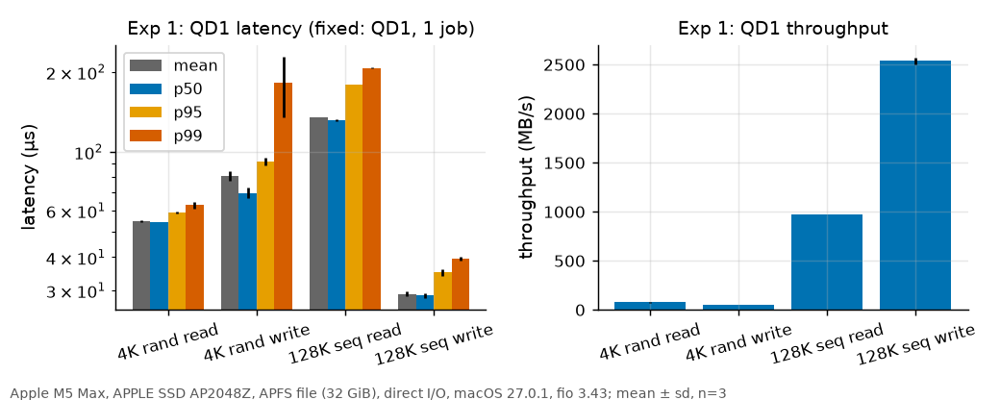
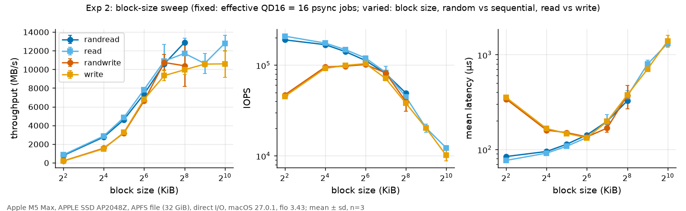
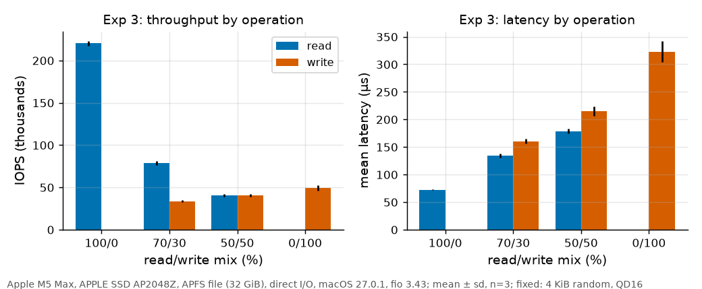
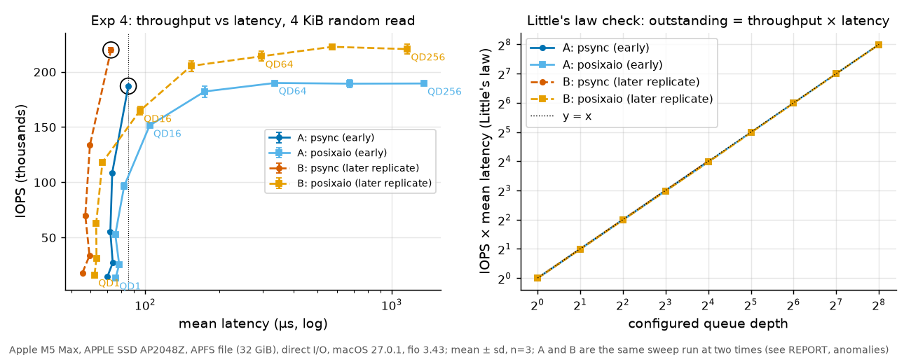
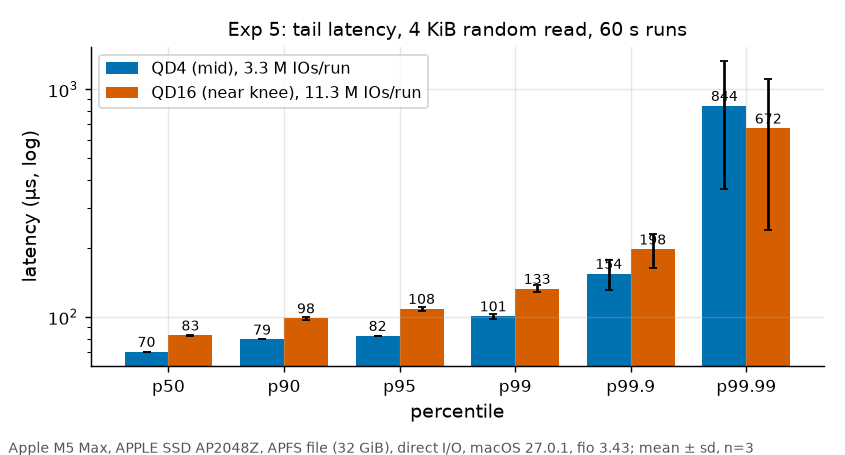
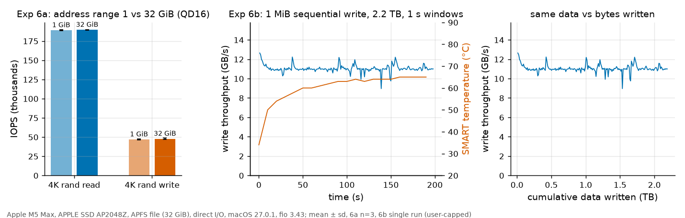
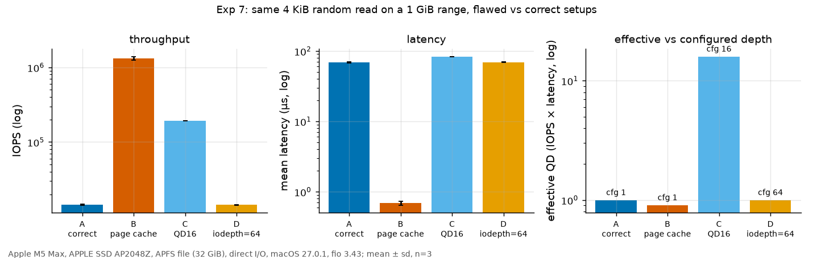
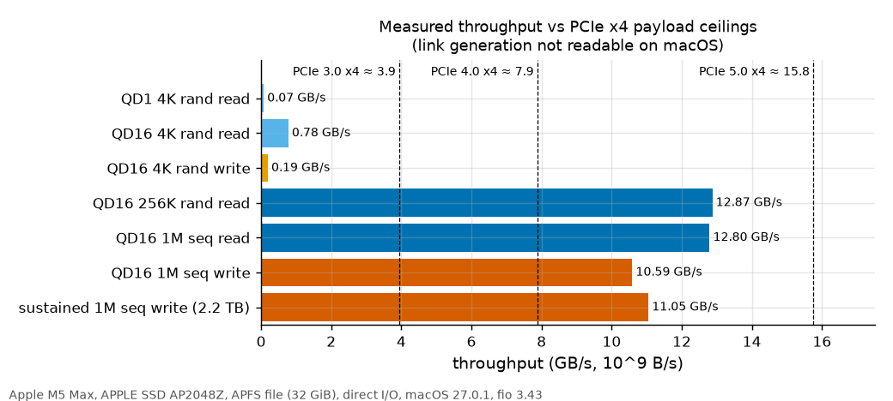

# Project 3: SSD Performance Profiling (Apple M5 Max internal NVMe, APFS)

Claims are labeled **measured** (directly in the data), **inferred** (follows from measurements plus a stated model) or **hypothesis** (plausible, not tested). Predictions made before data collection are in `HYPOTHESES.md` (committed first, with two dated amendments, both also made before any experiment data). All numbers below come from `data/processed/` and every table is generated from those CSVs by `scripts/make_tables.py`.

## Summary

- **Measured** 4 KiB random read at queue depth 1 takes 55 to 70 us (the two values come from two different machine states, see Anomaly 1); 128 KiB sequential read at QD1 takes 135 us (970 MB/s).
- **Measured** reads scale to 12.9 GB/s (256 KiB random read, QD16); 4 KiB random read saturates at 190 k (early run) to 222 k (later run) IOPS from QD64 upward. The knee of the throughput-latency curve is QD16 in both runs of the sweep. As a validity check, IOPS x mean latency equals the configured queue depth within 1% at every `psync` point and within 2.1% at every `posixaio` point up to QD256, so the effective depth is real (it is not an explanation of the knee, see Exp 4).
- **Measured** writes plateau at about 10 to 10.7 GB/s for blocks of 128 KiB and up, and 4 KiB random writes reach only 47 k IOPS (vs 190 k for reads).
- **Measured** a 2.2 TB sustained sequential write ran at a steady 11.0 GB/s with no cliff (first 10 s: 11.7 GB/s) while the SSD heated from 34 to 65 C. No SLC-cache exhaustion or throttling was observed.
- **Measured** page-cache reads are 90x the IOPS of direct reads (1.32 M vs 14.5 k IOPS, 0.69 us vs 68.6 us) on the same file, which is the negative example for Exp 7.
- The same read workload ran at two different speeds (about 189 k and 222 k IOPS) at different times in the campaign, for a reason that was not established. Treat absolute cross-experiment comparisons as carrying about 17% uncertainty; every experiment is internally consistent (see Anomaly 1).

## Methodology

| Item | Value |
|---|---|
| Machine | MacBook Pro, Apple M5 Max (6 performance + 12 efficiency cores), 36 GiB RAM |
| SSD | APPLE SSD AP2048Z, 2 TB, NVMe-class, controller integrated in the SoC ("Apple Fabric"), TRIM supported, S.M.A.R.T. passed, 0% wear. PCIe link generation and width are not readable on macOS (assumption, see roofline). |
| Filesystem | APFS (4 KiB blocks) on the boot volume, FileVault on (hardware encryption always active, part of every number). A file, not a raw device. |
| OS | macOS 27.0.1 (26A434). The machine was upgraded from 26.5.2 partway through the project; the precondition and every experiment ran on 27.0.1. The first engine check ran on 26.5.2 and was repeated (`data/raw/engine_check_macos26.5.2/` is superseded). |
| fio | 3.43 (Homebrew). Engines available: `psync`, `sync`, `vsync`, `pvsync`, `posixaio`, `mmap`, others non-I/O. **Not available:** `libaio`, `io_uring` (Linux only); detected at run time (`data/raw/engine_check_macos27.0.1/engines.txt`). |
| Test file | One 32 GiB file `scratch.noindex/testfile.bin` (the `.noindex` name keeps Spotlight out). Offsets cover 0 to 32 GiB (1 GiB for the range test), all block-aligned. |
| Preconditioning | File created with `mkfile` (sparse), then fully written once by 4 jobs x 8 GiB sequential 1 MiB writes with incompressible data (32.0 GiB at 6.2 GB/s; SMART host-write delta 34.38 GB) before any read test. |
| Data pattern | `refill_buffers=1`, `buffer_compress_percentage=0` for every job (incompressible, new random data per IO). |
| Direct I/O | `direct=1` everywhere except the deliberate buffered run in Exp 7. Verified three ways, below. |
| Queue depth | `psync` with `numjobs=N` gives effective depth N (fio allows only about 16 jobs because macOS limits System V shared memory to 4 MB system-wide). `posixaio` with `iodepth=N` in one process gives depth up to 256 on macOS 27 (`kern.aioprocmax=256`); the 26.5.2 limit was 16. Effective depth is always checked with Little's law. |
| Power and thermal | AC power, Low Power Mode off, battery held at 80% by macOS (AC attached, not charging). Each stage logs `pmset`, `smartctl` temperature and wear, free space and top CPU consumers before and after (`data/raw/health/`). SSD temperature: 29 to 36 C before stages, 65 C after the 2.2 TB write. |
| Background load | Apps closed as far as possible, Spotlight excluded by directory name, Time Machine idle (no local snapshots). The machine was **not** perfectly idle: desktop apps (editor, window server) were running at a few percent CPU. |
| Repetitions | 3 trials per point (mean and sample sd reported), except Exp 6b (one run, user-capped) and the drift time series. |
| Runtime / ramp | Exp 1: 30 s / 5 s. Exp 2: reads 15 s / 2 s, writes 4 s / 1 s (shortened to limit write wear, see AI_USE). Exp 3, 4, 6a: 20 s / 3 s. Exp 5: 60 s / 5 s. Exp 7: 20 s / 5 s. Exp 6b: no ramp, stops at 2.2 TB or 300 s. |
| Run validity | Every run is checked before and after: must be on AC power and finish within runtime + ramp + 45 s. Runs that fail are moved to `data/raw/invalid/` and the stage aborts. |
| Reproduce | `bash scripts/run_all.sh` (README). |

**Direct I/O verification** (`F_NOCACHE` itself was not traced: syscall tracing with `dtruss` needs sudo and relaxed SIP and was not attempted, so the evidence is behavioral):

1. Same file, same 1 GiB range, QD1 4 KiB random read, 20 s: `direct=1` gave 16,251 IOPS and 61.4 us mean; `direct=0` gave 1,289,998 IOPS and 0.70 us (87x latency difference). The check script stops the whole campaign if `direct=1` looks cache-like (mean under 15 us or within 3x of buffered). It passed.
2. SMART "Data Units Read" counts what the SSD actually served. If a cache answered the reads SMART would be lower than fio's byte count; it was never lower:

{{table:smart_read_check}}

   The excess over 1 comes mostly from ramp-time IO that fio does not count. Exp 3 and 4 show 1.55 against about 1.15 expected, an unexplained residual (Exp 3 contains writes; **hypothesis**: write-induced device reads such as read-modify-write or garbage collection).
3. Writes: fio bytes equal the SMART "Data Units Written" delta to 0.01% (Exp 6b table below).

## Exp 1. Zero-queue baselines (QD1, 1 job)

**Hypothesis:** 4K random read 60 to 90 us; 4K random write 20 to 60 us and faster than read; 128K sequential read 70 to 150 us (0.9 to 1.8 GB/s); 128K sequential write 80 to 200 us; p99 1.5 to 3 x p50.

{{table:exp1}}

**Result vs hypothesis.** Random read latency (54.6 us) is below the predicted range, and random write (80.9 us mean) is **slower** than read, the opposite of the prediction. Sequential read matches (135 us, 970 MB/s). Sequential write is well below the predicted range (29 us per 128 KiB vs 80 to 200 us). The random-read tail is much tighter than predicted (p99/p50 = 1.16); random-write p99 is 2.6x p50, as predicted.

**Interpretation.** *Inferred:* a 4 KiB read costs one flash page read plus controller, encryption, PCIe and kernel time, about 55 to 70 us in total, and nothing overlaps at QD1. Sequential 128 KiB reads cost 135 us because 32 pages must be read and transferred. A 128 KiB write finishing in 29 us means the SSD acknowledges writes from a fast buffer before programming flash (programming takes far longer than 29 us). Random 4 KiB writes are slower than reads (81 vs 55 us) and have a heavy tail (p99 181 us, sd 46 us), *hypothesis:* because APFS is copy-on-write, so each overwrite allocates new blocks and updates file-system metadata, whereas large sequential writes allocate contiguously. Note on method: the 128 KiB sequential-write throughput (2.5 GB/s) is limited partly by fio generating 128 KiB of random data per IO outside the measured latency (Little's law gives 0.56 busy, i.e. 44% of each cycle is outside the IO), so that row's throughput understates the device; its latency is unaffected.

## Exp 2. Block-size sweep (effective QD16)

**Hypothesis:** throughput saturates at 5 to 7 GB/s for random read; latency flat to 16 KiB then linear; random approaches sequential from 128 KiB; writes saturate at 2 to 5 GB/s.

{{table:exp2}}

**Result vs hypothesis.** Reads saturate at 10.6 to 12.9 GB/s, about twice the prediction. Writes plateau at 9.3 to 10.7 GB/s, also far above the 2 to 5 GB/s predicted (Amendment A noted this early from a 5 s probe). Random vs sequential is nearly identical at every size (4 KiB: 778 vs 854 MB/s, 9%; 128 KiB and up: within noise), so the gap exists but is small. Write IOPS is **not** monotonic: 4 KiB writes manage 45 to 47 k IOPS, 16 to 64 KiB writes reach about 100 k.

**Interpretation.** *Inferred:* at QD16 the large-block points are bandwidth-bound and Little's law then fixes the latency: 16 x 256 KiB / 12,872 MB/s = 326 us, exactly the measured 326 us; 16 x 1 MiB / 12.8 GB/s gives 1.31 ms against 1.315 ms measured. Reads of 12.9 GB/s are above the PCIe 4.0 x4 payload limit (7.9 GB/s), so the link must be faster than that; the link could not be read on macOS. Random equals sequential because the SSD has no seek cost and direct I/O removes read-ahead; striping makes a 128 KiB request touch many channels anyway. *Hypothesis:* the jump in write IOPS from 4 KiB to 16 KiB (47 k to 95 k) and the flat 92 to 104 k IOPS across 16 to 64 KiB suggest a native 16 KiB page: a 4 KiB write is a partial-page operation, and above that a per-operation cost in the write path (latency of 133 to 166 us per operation across 16 threads) dominates until bandwidth takes over at 128 KiB. Read IOPS dropping only from 190 k to 168 k between 4 and 16 KiB fits the same page size.

Write points of 32 KiB and larger show Little's QD of 13.7 to 14.6 (flagged), and 16 KiB shows 15.2, not 16 (**measured**). **Inferred** to be fio itself: each thread spends 9 to 14% of its cycle generating random data and in the syscall return path, outside the measured latency, so the device sees about 14 outstanding writes. The read points all give 16.0.

## Exp 3. Read/write mix (4 KiB random, QD16)

**Hypothesis:** mixed total IOPS below a linear blend of the pure cases; read latency 1.3 to 3x higher at 50/50.

{{table:exp3}}

**Result vs hypothesis.** Read mean latency at 50/50 is 2.5x the pure-read value (72 to 179 us), inside the predicted range. Read p99 rises 12x (108 to 1330 us). Total IOPS is far below the arithmetic blend (50/50 would be 135 k), but it is **exactly** the time-weighted (harmonic) blend: 1 / (0.5/220.4 k + 0.5/49.4 k) = 80.7 k predicted vs 81.0 k measured, and 108 k predicted vs 112.3 k measured at 70/30.

**Interpretation.** *Inferred:* each read costs about 4.5 us of device-slot time and each write about 20 us; a mix just averages those costs, so the penalty predicted from read/write interference is **not** needed to explain throughput. Interference shows up in the tail instead: reads queue behind slow writes in the shared 16-deep queue, which raises read p99 by an order of magnitude. Write mean latency is lower in a mix (215 us at 50/50 vs 323 us pure) because fewer writers are queued at once (Little's law: about 9 writers).

## Exp 4. Queue-depth sweep (4 KiB random read) and Little's law

**Hypothesis (with Amendments A and B):** IOPS rises about linearly to QD8 to 16, saturates at 180 to 250 k IOPS, knee at QD8 to 32 (smallest QD with at least 90% of peak IOPS), latency then grows as QD / peak IOPS, Little's law agrees with configured QD within 5% for `psync`.

The sweep was run twice, early (A) and again about 54 minutes after the early sweep (B), because the identical workload had given two different speeds (Anomaly 1).

{{table:exp4}}

**Result vs hypothesis.** Peak IOPS is 189.9 k (A) and 222.7 k (B), both in the predicted range. The knee by the stated rule is **QD16** in both runs (psync QD16 reaches 98.5% of A's peak and 98.7% of B's; QD8 only 57% and 60%). Little's law matches the configured depth within 1% for every `psync` point and within 2.1% for every `posixaio` point up to 256 (254.5 to 255.1 at QD256), so no point is flagged. Plateau latency follows QD / IOPS: QD256 / 189.4 k = 1.351 ms against 1.347 ms measured (A); 256 / 220.6 k = 1.160 ms against 1.154 ms (B).

**Little's law is a check here, not an explanation.** In a closed-loop fio run each of N workers issues its next IO only after the previous one completes, so IOPS x mean latency equals N nearly by construction. Its value is as a validity check on the effective queue depth: it confirms that `psync` with `numjobs=N` and `posixaio` with `iodepth=N` (up to 256) really keep N IOs outstanding, and it shows when they do not (`psync` with `iodepth=64` gives 1.00, because a synchronous engine collapses to QD1; Exp 7). It says nothing about why throughput stops growing.

**The knee comes from saturation (inferred).** Evidence: (1) IOPS rises almost linearly to QD8 (7.6x the QD1 rate), bends at QD16 (13.1x) and is flat from QD64 to QD256 (A: 189.9 k, 189.3 k, 189.4 k; B: 214.1 k, 222.7 k, 220.6 k) while mean latency grows in proportion to depth; (2) two different submission mechanisms, `psync` threads and `posixaio`, end at the same ceiling, so it is not the overhead of one engine (`psync` is faster below QD32, 187 k vs 151 k at QD16 in A, *hypothesis:* because `posixaio` hands each IO to a small kernel thread pool); (3) the limit is not interface bandwidth: the same drive moves 12.9 GB/s with 256 KiB reads at only 49 k IOPS, against 0.78 GB/s at 190 k IOPS for 4 KiB, so the 4 KiB ceiling is a per-command limit (controller command rate and flash parallelism, plus the host kernel path); (4) fio uses about 2.2 of the 18 cores' worth of CPU, so the host is not out of CPU. **Not established:** how the ceiling splits between controller, firmware and host path. The 17% shift between the two machine states (Anomaly 1) shows that the 4 KiB ceiling is not a pure device property.

## Exp 5. Tail latency (4 KiB random read, 60 s, 3 trials)

**Hypothesis:** mid-QD (QD4): p99 1.5 to 2.5 x p50, p99.9 3 to 8 x p50; at the knee the spread p99.9/p50 is wider than at mid-QD.

{{table:exp5}}

**Result vs hypothesis.** Sample counts: 3.3 M IOs per run at QD4 (about 3,300 samples above p99.9) and 11.3 M at QD16 (about 11,300). p99/p50 is 1.43 at QD4 (just below the predicted range) and p99.9/p50 is 2.2, well below the predicted 3 to 8x, so the tail is **tighter** than expected. The knee run has a slightly larger p99.9/p50 (2.39 vs 2.20), but the difference is under one standard deviation of p99.9 (sd 23 to 34 us), so no claim is made. p99.99 is unreliable (sd 430 to 480 us on a mean of 670 to 840 us, only about 300 to 1,100 samples per run).

**Interpretation.** *Inferred:* reads at moderate depth have almost no interference sources (no writes, no garbage collection), so the tail is mostly queueing: going from QD4 to QD16 raises p50 by 18% (70 to 83 us) and p99 by 32% (100 to 133 us). The maximum latencies (6 to 13 ms) are rare outliers, *hypothesis:* OS scheduling or controller housekeeping events, not distribution tails. This experiment ran in the slower machine state (Anomaly 1).

## Exp 6. Working set and device state

### 6a. Address range (4 KiB random, QD16)

**Hypothesis:** 1 GiB vs 32 GiB within 10% for reads and within about 20% for writes.

{{table:exp6a}}

**Result.** Reads: 189.1 k vs 189.6 k IOPS (0.3% apart). Writes: 46.9 k vs 47.8 k (1.8%). The hypothesis holds, with a much smaller difference than allowed. *Inferred:* flash read and program costs do not depend on the logical range and the controller's mapping cache is not limiting at 32 GiB.

### 6b. Sustained sequential write (1 MiB, 4 jobs, cap 2.2 TB or 300 s)

**Hypothesis:** burst 4 to 6 GB/s; about 50% chance of a visible drop after cache exhaustion.

{{table:exp6b}}

**Result.** No cliff. Throughput fell from 12.6 GB/s in the first second to about 11.0 GB/s by 10 to 15 s (a 13% initial burst effect) and stayed there for the rest of the 198 s run and 2.2 TB (slowest 1 s window 8.96 GB/s; last 30 s 11.04 vs 10 to 60 s 10.99 GB/s). The cap of 2.2 TB, not the 300 s limit, ended the run (198 s). Also checked: p99.9 write latency 4.0 ms and max 19.6 ms (no stalls), SMART temperature (rose to 65 C with no throughput change), and that fio and SMART byte counts agree. No cliff was invented: **this is a single run, and the absence of a cliff reflects the limits of the test (the drive was never filled; the 2.2 TB went to one 32 GiB logical range), not proof that no SLC-style cache exists.**

**Interpretation, and what this test cannot show.** *Inferred:* the write path sustained about 11 GB/s with no sign of throttling at 65 C. *Hypothesis:* the file is overwritten in place logically (32 GiB) but APFS is copy-on-write, so the SSD sees new blocks each time and the old ones are TRIMmed, which means the drive always had plenty of free blocks; a cliff would need the drive to be filled, which the 20%-free-space safety rule forbids. The unplanned 12 GB/s write speed is twice the 3 to 6 GB/s assumed; the byte cap replaced the original 300 s-only plan, which would have written about 3.3 TB at the measured rate.

## Exp 7. Misleading setup (page cache), shown next to the correct one

**Hypothesis:** buffered reads show 1 to 5 us and 50 to 300x the IOPS of direct reads; `psync` with `iodepth=64` behaves like QD1.

{{table:exp7}}

**Result.** Buffered (B) delivers 1.32 M IOPS at 0.69 us mean, **90.6x** the IOPS and 99x lower latency than the correct direct run (A, 14.5 k IOPS, 68.6 us). That is 1.32 M x 4 KiB = 5.4 GB/s of "reads" from a device whose real random-read ceiling at QD1 is 60 MB/s. The latency is below the predicted 1 to 5 us: fio recorded a minimum of 0 ns, so many memory hits complete faster than its timer resolves, and its percentile histogram reports its lowest populated bin (1.00 us) for p50 and p99 (**inferred**, not separately tested). D (`iodepth=64` on a synchronous engine) is identical to A (14,395 vs 14,540 IOPS, Little's law 1.00 effective against 64 configured, flagged).

**Mechanism.** *Measured:* with the same file and job and only `direct` changed, the answer comes from RAM. *Inferred:* buffered `pread` hits the unified buffer cache, never reaches the NVMe queue and never touches flash (the 1 GiB range fits in 36 GiB RAM and is warm after the first pass). Proof by difference: A, B and C (QD16, 191.8 k IOPS) were run back to back on the same file, and B exceeds the real device ceiling by 6x. D shows the other classic mistake: the number "64" in the job file is not the depth the device saw.

## Roofline-style summary: interface and device ceilings vs measured

| Quantity | Value | Basis |
|---|---|---|
| Best random-read IOPS (4 KiB, QD16 to 256) | 190 k to 223 k (two machine states) | measured |
| IOPS-bound bandwidth at that rate | 0.78 to 0.91 GB/s, about 6 to 7% of the best read bandwidth | measured: small reads are IOPS-bound, not bandwidth-bound |
| Best read bandwidth (256 KiB to 1 MiB) | 12.9 GB/s | measured |
| Best write bandwidth (128 KiB to 1 MiB, short runs) | 10.6 GB/s; sustained 11.0 GB/s over 2.2 TB | measured |
| PCIe payload ceilings, x4 | Gen3 3.9, Gen4 7.9, Gen5 15.8 GB/s | public spec; link not readable here |
| Conclusion | 12.9 GB/s exceeds Gen4 x4, so the drive runs at Gen5-class link speed or an Apple-specific link; reads reach 82% of Gen5 x4, so a link-bound read ceiling is plausible | inferred, assumption about link |

Latency floor: QD1 4 KiB read is 55 to 70 us, which is above raw flash read time (tens of us), consistent with controller, encryption, protocol and file-system overhead on top of the flash read.

## Hypothesis scorecard

| Exp | Prediction | Outcome |
|---|---|---|
| 1 | 4K rand read 60 to 90 us | Missed low in Exp 1 (54.6 us); in range in the other machine state (68.6 to 70.1 us) |
| 1 | 4K rand write faster than read | **Wrong** (80.9 vs 54.6 us) |
| 1 | 128K seq read 70 to 150 us | Hit (135 us) |
| 1 | 128K seq write 80 to 200 us | Missed (29 us) |
| 2 | Read plateau 5 to 7 GB/s | Missed (10.6 to 12.9 GB/s) |
| 2 | Write plateau 2 to 5 GB/s | Missed (9.3 to 10.7 GB/s) |
| 2 | Random approaches sequential at 128K | Hit (and also at 4K, within 9%) |
| 3 | Mix total below linear blend | Hit, but the cause is time-weighting, not interference |
| 3 | Read latency 1.3 to 3x at 50/50 | Hit (2.5x mean; 12x at p99) |
| 4 | Saturation 180 to 250 k, knee QD8 to 32 | Hit (190 k and 223 k, knee QD16) |
| 4 | Little's law within 5% for `psync` | Hit (within 1%) |
| 4 | `posixaio` effective QD stays near 16 | Withdrawn in Amendment B (true only on macOS 26.5.2) |
| 5 | p99.9 = 3 to 8 x p50 | Missed (2.2 to 2.4x) |
| 6a | Range within 10% (read), 20% (write) | Hit (0.3%, 1.8%) |
| 6b | Burst 4 to 6 GB/s, maybe a cliff | Burst far higher (11.7 GB/s); no cliff |
| 7 | Buffered 50 to 300x IOPS | Hit (90x) |
| 7 | `iodepth` ignored by `psync` | Hit |

## Anomalies (hypotheses are labeled)

1. **Two performance levels for an identical workload.** 4 KiB random read at 16 `psync` jobs gave 187 to 192 k IOPS in Exp 2, 4, 5, 6a and 7, and 215 to 224 k IOPS in Exp 3, the drift check, a 30-run time series (6 minutes, stable at 222 k) and the Exp 4 replicate (Fig 8). It is visible at QD1 too (55.6 us vs 70.1 us mean), so it is not only thread placement at saturation. In the high level fio's kernel CPU use is about 262% of a core vs about 209% in the low level (**measured**; a consequence, not a cause). **Analysis of existing data only (no new runs)**, over the 57 runs of this workload (15 low, 42 high), which form four consecutive episodes, so every factor is effectively tested on four episodes:

{{table:state_split}}

   Power source: AC for all 57 runs (battery held at 77 to 80%), so there is no variation to explain anything. Sleep: none during any run. Thermal: SMART temperatures exist only at stage boundaries, they overlap between levels and there is no per-run reading, so there is no evidence either way. Display on: 12 of 15 low runs vs 42 of 42 high runs (weak, a rough proxy for user activity). Run order correlates (r = +0.68) only because of the episode layout. The strongest association is the volume written in the 30 minutes before the run (r = +0.92; mean 2,136 GB before high runs vs 308 GB before low runs). It is confounded with run order and one episode contradicts it: Exp 4's QD16 runs at 22:43 were low although 1.5 TB had been written about 12 minutes earlier. **Conclusion: no single factor accounts for the split; recent write volume is the only candidate that lines up, and it is an untested hypothesis.** Other **untested hypotheses:** a storage or SoC power or clock state, macOS scheduler placement of the fio threads on performance vs efficiency cores, background system activity. **Consequence:** absolute numbers from different experiments carry about 17% uncertainty; comparisons within one experiment hold (Exp 7 compares A, B, C and D within minutes). Exp 1's QD1 read latency (54.6 us) matches the high level (55.6 us in the replicate); Exp 7's QD1 read (68.6 us) matches the low level (70.1 us).
2. **Exp 2 write results were first invalid.** The first pass showed single writes lasting up to 180 s and standard deviations above the mean. Cause (from `pmset -g log`): the charger was unplugged and the lid closed, and the Mac slept repeatedly mid-run. The 42 affected files are kept in `data/raw/invalid_sleep_2026-10-22/` and excluded; the runs were repeated under per-run power checks, `caffeinate` and a wall-clock validity check, and the repeated results are stable (sd 0.5 to 21% of the mean, largest at 256 KiB and 1 MiB). Drive-level stalls were the first suspicion; a diagnostic job was written for that and removed unused once the sleep log explained the stalls.
3. **OS upgrade mid-project.** macOS went from 26.5.2 to 27.0.1; `kern.aiomax` 90 to 1024 and `kern.aioprocmax` 16 to 256 changed, so the `posixaio` effective depth went from 16 to 256 and the first engine conclusion became wrong. `smartctl` also reports a different firmware string (2973.120 before, 241.0.12 after). `HYPOTHESES.md` was amended (Amendment B) before any experiment data.
4. **Writes show Little's QD below 16** (13.7 to 14.6 at 16 jobs): fio's per-IO random-data generation sits outside the measured latency (Exp 2 and Exp 1 notes).
5. **4 KiB random writes are slower than 16 KiB writes in IOPS** (47 k vs 95 k): *hypothesis:* partial-page writes.
6. **Exp 3 and 4 SMART read delta is 1.55x fio's count** vs 1.15x expected from ramp time: unexplained.
7. **p99.99 is statistically weak** (sd as large as the mean); reported but not interpreted.

## Limitations and Apple-specific caveats

- One machine, one file, one filesystem. The SSD controller is inside the SoC; FileVault encryption, APFS copy-on-write and the OS cache layers cannot be turned off, so "SSD performance" here means file-on-APFS performance. Logical file offsets are not device LBAs; the controller remaps them freely.
- `F_NOCACHE` direct I/O bypasses the page cache but is not a durability test: no `F_FULLFSYNC`, so write latencies are acknowledgements from the device's buffer, not persistence. Write results say nothing about power-loss behaviour.
- macOS has no blktrace and no `iostat` with Linux's per-device queue and utilisation parity; what could be observed: fio's latency histograms, SMART counters (temperature, host bytes read and written, wear), `pmset` logs, per-process CPU. What could not: device queue depth inside the controller, SSD temperature at finer than 10 s steps, PCIe link state, firmware GC or SLC state, and syscall-level `F_NOCACHE` tracing (needs sudo and relaxed SIP).
- fio can run only about 16 jobs on this Mac (System V shared memory 4 MB), so `psync` depths above 16 do not exist; deeper depths use `posixaio`, whose latency includes thread hand-off overhead.
- The sustained write is a single run and cannot show variance. It did not fill the drive, so it cannot expose steady-state behaviour of a nearly full SSD.
- A 4 s run for Exp 2 writes gives millions of IOs for small blocks but only about 40 GB for large ones; the results are short-window means, not steady state (Exp 6b is the steady-state check, and agrees with the 10 to 11 GB/s plateau).

## AI use

See `AI_USE.md`.
