# Project A1: Cache/TLB Behavior, QoS Scheduling, and Their Interaction on Apple M5 Max

ECSE 4320/6320 Advanced Computer Systems. All data, scripts and plots are in this repository; every claim cites a plot (`plots/`), a processed table (`data/processed/`) or a raw file (`data/raw/`). Hypotheses were written before the corresponding data was collected (`docs/HYPOTHESES.md`, git history) and are marked **supported**, **partly supported** or **refuted** below.

## 1. Summary

I studied two mechanisms and one interaction on a MacBook Pro (Apple M5 Max, 6 "Super" + 12 "Performance" cores, 36 GB unified memory, 16 KB pages, macOS 26.5.2).

1. **Cache and TLB behavior.** Random pointer-chase latency shows an L1 plateau of 0.66 ns up to 128 KB, a 2.6 ns plateau, a 7 to 8 ns L2 plateau, a ramp from 16 MB to 128 MB, and a DRAM plateau of 105 to 111 ns. TLB reach shows up as a penalty of 1.3 ns at 256 pages and 18.5 ns at 65536 pages.
2. **Scheduling via QoS.** On this chip thread QoS classes do not change a single thread's speed or core type, and do not change CPU share under heavy contention. Process-level policy does: `taskpolicy -b` or `-c background` moves a process to Performance cores, slows it 3.3x, and under contention cuts its CPU share to about 1%. Thread QoS `background` also moves threads to Performance cores and slows them 3.3x or more, but only with 4 or more threads.
3. **Interaction.** Moving a process from Super to Performance cores (via background policy) changes latency by a baseline factor of about 3.3x, plus extra spikes of 22x at 128 KB and 11x at 8 MB, exactly where the tiers' L1D (128 vs 64 KB) and L2 (16 vs 8 MB) capacities differ. So the core tier changes where the cache cliffs appear, not only how high the latency is.
4. **AI-resilience checkpoint.** My first, "obvious" pointer chase (each node points to the next one in memory) reported 7.8 ns at 1 GB instead of 108 ns. It measured the hardware prefetcher, not memory latency (Section 7).

## 2. Environment and method (short)

Full detail: `docs/ENVIRONMENT.md`, `docs/METHODOLOGY.md`.

| Item | Value |
|---|---|
| Chip | Apple M5 Max, 18 cores: 6 Super (L1D 128 KB, L2 16 MB) + 12 Performance (L1D 64 KB, L2 8 MB), no E cores, no SMT |
| Memory | 36 GB unified, 16 KB pages, 128 B lines |
| OS and compiler | macOS 26.5.2, Apple clang 21.0.0, `-O2 -mcpu=native` |
| Power | AC, Low Power Mode off, `caffeinate -dimsu`, thermal state recorded before and after each run |
| Counters | No raw cache/TLB miss counters. Instruments CPU Counters (via `xctrace`, no sudo) provides per-thread core type and a cycles/bottleneck breakdown, used for placement. No `sudo` command was run. |

Rigor controls: single monotonic clock (41 ns tick, 6.6 to 9.0 ns call overhead, `data/processed/noise_summary.csv`), timed regions of at least 20 ms, fixed-work noise floor IQR/median 0.5% to 0.6%, every chase verified as one full cycle (and unit-tested, `tests/test_harness.c`), 10 to 15 repetitions per point across shuffled rounds, warmups excluded, median, IQR and min reported, throttled rows excluded (0 occurred in any experiment) and rows with page faults in the timed region excluded (11 of 585 in the random-chase run and the same 11 in the S condition of the interaction run, counted in `n_faulted`).

Where the reproduced assignment text said "P and E cores", this chip has two high-performance tiers, so the interaction is **Super vs Performance** (approved by the user in Phase 0). Thread-to-core pinning is not available on macOS. Placement is steered by QoS and `taskpolicy`, and verified by Instruments for the sampled runs (`data/raw/coretype_*.csv`); it is observed, not guaranteed.

## 3. Mechanism 1: cache and TLB behavior

**Question.** How do latency and bandwidth depend on working set, stride and access pattern, and where are the L1, L2, SLC, DRAM and TLB boundaries? Design, controls, metrics and predictions: `docs/HYPOTHESES.md` (Phase 2).

### 3.1 Latency vs working set (H1a: partly supported)

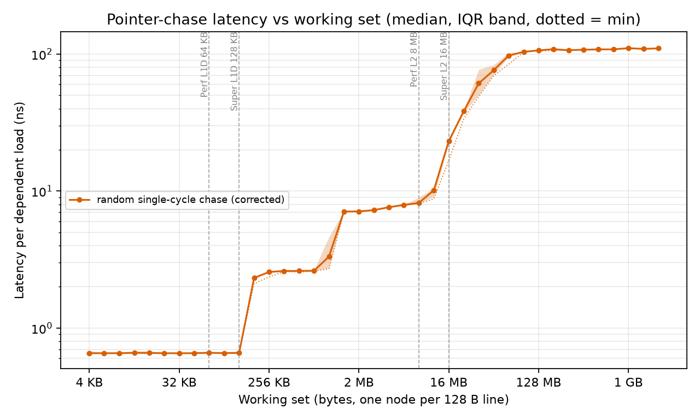

Data: `data/raw/chase_random_*.csv`, `data/processed/chase_random.csv`.

| Working set | Median ns (IQR) | Reading |
|---|---|---|
| 4 KB to 92 KB | 0.66 (0.65 to 0.67) | L1 hit, a few cycles (known-answer range met) |
| 256 KB | 2.57 (2.56 to 2.60) | first plateau above L1 |
| 740 KB | 2.62 | same plateau |
| 2 MB | 7.11 (7.09 to 7.14) | L2 plateau |
| 5.9 MB | 7.92 | L2 plateau |
| 16.8 MB | 23.2 (22.2 to 23.7) | crossing the 16 MB Super L2 |
| 47 MB | 76.3 | ramp |
| 134 MB | 106.4 | DRAM plateau |
| 1 GB | 110.5 (110.3 to 112.4) | DRAM plateau |

Verdict by prediction: the L1 edge at 128 KB (supported, matches `hw.perflevel0.l1dcachesize`); a DRAM plateau of 80 to 130 ns (supported); boundaries within a factor of 2 of sysctl sizes (supported); an L2 plateau of 3 to 6 ns (refuted, measured 7 to 8 ns); a distinct SLC plateau at 10 to 30 ns (refuted: the region from 16 to 128 MB is a continuous ramp, so the SLC size cannot be read from this curve). Unexplained: a 2.6 ns step between 128 KB and 1 MB before the 7 ns L2 plateau; I think it is a fast portion of L2, but this is inferred and unverified (no miss counters).

### 3.2 TLB reach (H1b: partly supported)

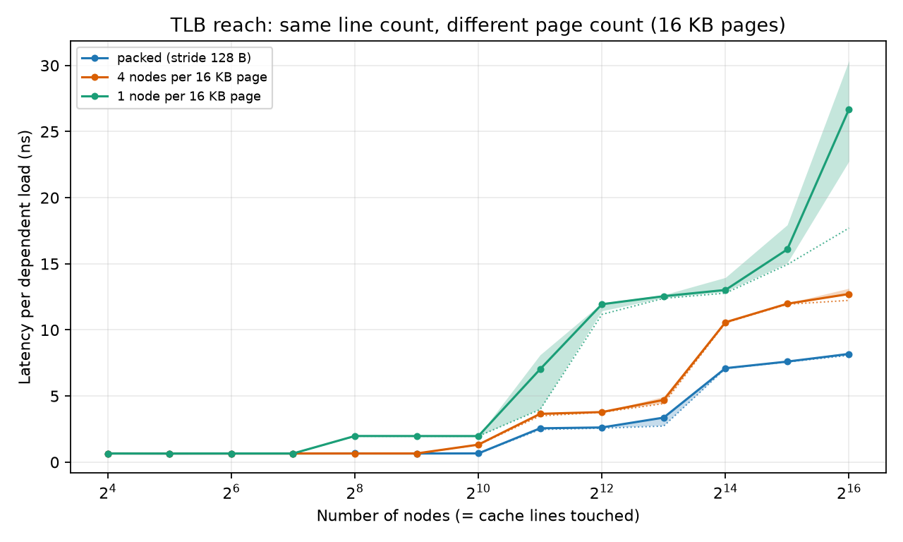

Data: `data/raw/chase_tlb_*.csv`. Same number of cache lines, packed (128 B stride) vs one node per 16 KB page:

| Nodes | Packed ns | One per page ns | Penalty |
|---|---|---|---|
| 128 | 0.7 | 0.7 | 0 |
| 256 | 0.7 | 2.0 | +1.3 (first TLB level miss) |
| 2048 | 2.6 | 7.0 | +4.4 |
| 4096 | 2.6 | 11.9 | +9.3 |
| 65536 | 8.2 | 26.7 | +18.5 |

The first penalty at 256 pages matches the prediction (256 to 1024 pages). The large penalty arrives at 2048 to 4096 pages, earlier than the predicted 4096 to 16384 pages. The +18.5 ns at 65536 pages exceeds the predicted 10 ns. Because pages are 16 KB, 256 pages cover only 4 MB, which is small compared with typical 4 KB-page reach.

### 3.3 Bandwidth and the prefetcher (H1c: partly supported)

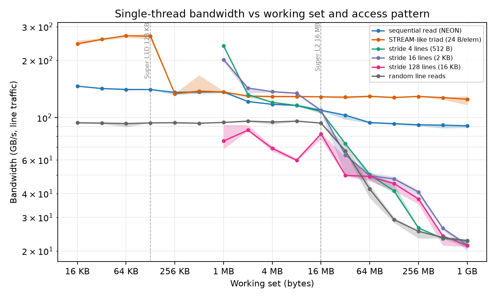

Data: `data/raw/bw_*.csv`. Single thread, GB/s (median).

| Working set | Sequential read | Random lines | Triad (24 B/elem) |
|---|---|---|---|
| 16 KB | 146 | 94 | 245 |
| 8 MB | 116 | 96 | 129 |
| 16 MB | 110 | 94 | 129 |
| 1 GB | 90.7 | 22.7 | 125 |

Sequential beats random by 4.0x in DRAM (prediction of at least 3x: supported) but only 1.2x at 8 MB (not predicted; the prefetcher advantage is a DRAM-regime effect, because L2 latency is small enough for out-of-order overlap alone). The triad exceeds sequential read by 38% at 1 GB, outside the predicted 30%; the two differ in bytes counted (triad counts the write) and in access mix, so this cross-check agrees in magnitude but not within the stated tolerance. Flagged and not resolved: stride-4 and stride-16 kernels report 238 and 202 GB/s at 1 MB, above the 137 GB/s sequential rate at the same size; I did not validate these two points.

### 3.4 Failure modes of Mechanism 1

- Working sets inside one level show a flat curve (the first 11 points of 3.1 are all 0.65 to 0.66 ns); only the sweep across levels is informative.
- A prefetchable access pattern turns a latency probe into a bandwidth probe (Section 7).
- Random-chase latency in the 16 to 128 MB range has the widest IQR (up to 12 ns at 47 MB), because the result depends on SLC/TLB state and on the specific random permutation; I used one fixed permutation seed, so permutation-to-permutation variance is not measured.
- No miss counters: level attributions are by curve shape and sysctl sizes only.

## 4. Mechanism 2: scheduling and isolation via QoS

**Question.** What do thread QoS classes and process-level policies change in throughput, tail latency, variance and CPU share for compute-bound and memory-bound fixed-work loops? Predictions: `docs/HYPOTHESES.md` (Phase 3, which discloses that short pilot probes preceded it, so those hypotheses are weaker evidence). Data: `data/raw/qos_*.csv`, `data/processed/qos_*.csv`. Placement probes: `data/raw/coretype_*.csv`.

### 4.1 Idle machine, one thread (H2a, H2b: supported)

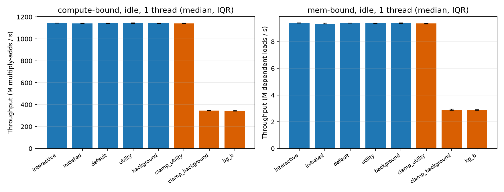

| Configuration | Compute (M mul-adds/s) | DRAM chase (M loads/s) | Core type observed |
|---|---|---|---|
| thread QoS interactive, initiated, default, utility, background | 1141 to 1144 | 9.35 to 9.39 | 99.2% to 100% Super |
| `taskpolicy -c utility` | 1141 | 9.36 | 100% Super |
| `taskpolicy -c background` | 345 | 2.87 | 100% Performance |
| `taskpolicy -b` | 344 | 2.89 | 100% Performance |

Thread QoS changes nothing for a single thread (spread under 0.3%). Process-level background policy is 3.3x slower for both compute and DRAM, with IQR/median at most 2.8%. A pure core-microarchitecture difference would not slow a dependent integer chain 3.3x (Performance cores at default policy ran it at the same speed as Super cores, Section 4.2), so the policy also lowers clock or priority; I cannot separate those without power or frequency counters.

### 4.2 Thread count (H2c: partly supported)

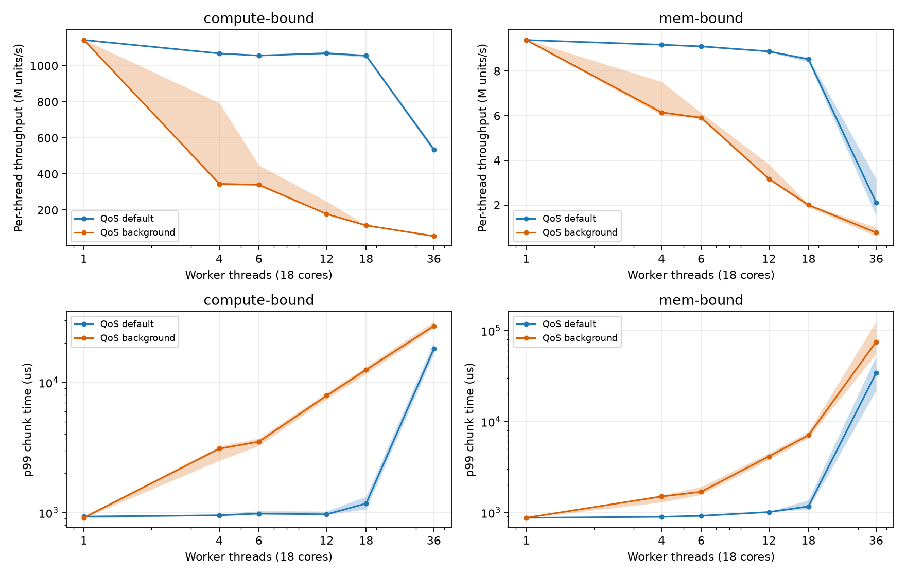

Per-thread compute throughput (M/s), QoS default: N=1 1142, N=4 1068, N=6 1056, N=12 1069, N=18 1055, N=36 535. At N=18 the per-thread IQR is 1045 to 1061 M/s (1.5% spread) across 18 threads that must occupy both tiers, so Performance cores at default policy match Super cores on this loop. N<=6 is 6.5% to 7.6% below N=1, just outside the predicted 5%; N=12 and 18 are within the predicted 10%. At N=36 (2x oversubscribed) `cpu_over_wall` falls to 0.50 and p99 chunk time is 18.1 ms vs 0.93 ms at N=1 (19x), as predicted.

**Unpredicted finding.** With thread QoS `background` and N>=4 threads, per-thread throughput drops: N=4 345 (3.3x), N=12 178, N=18 115, N=36 56 M/s, while default, initiated, interactive and utility stay near 1060. An Instruments probe of 4 background-QoS threads shows 75% of on-core time on Performance cores (default and utility: 99% Super). So thread-level background QoS does steer placement and speed, but a single background thread on an idle machine stayed on Super. The mechanism (a scheduler rule that depends on thread count or load) is inferred, not established.

### 4.3 Contention (H2d, H2e: supported)

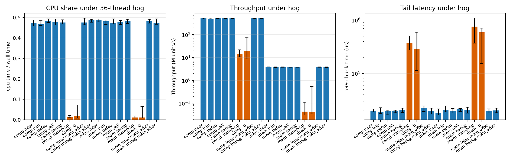

Competing load: a separate process with 36 spinning interactive-QoS compute threads (2x oversubscription).

| Worker | CPU share (cpu/wall) | Compute M/s | p99 chunk |
|---|---|---|---|
| any of 5 thread QoS classes | 0.467 to 0.488 | 500 to 515 | 19 to 21 ms |
| QoS set on the main thread after workers started | 0.47 to 0.49 | 509 to 521 | 20 to 23 ms |
| `taskpolicy -c background` | 0.014 | 14.8 | 369 ms |
| `taskpolicy -b` | 0.018 | 19.1 | 288 ms |

Thread QoS gave no isolation (all about the 18/37 fair share). Process policy cut CPU share to 1% to 2% and raised p99 by 15x to 19x over the hog baseline, and 300x to 400x over the idle baseline (0.93 ms). The memory loop behaves the same way (cpu/wall 0.011 vs 0.47 to 0.49; p99 593 to 754 ms). The prediction ">100x" holds against idle, not against the hog baseline.

### 4.4 Failure modes of Mechanism 2

- QoS is a hint: results differ by configuration in non-obvious ways (single thread: no effect; four threads at background: 3.3x slower), so a single-configuration test is misleading (Section 7.2).
- Starvation makes fixed-work runs long (about 52 s per 200-chunk repetition under `-b`); I reduced chunks to 10 or 20 for those points and recorded the chunk count in the data.
- Placement evidence is sampled (10 ms) and per process; threads may migrate.

## 5. Interaction: core tier x working-set size

**Question.** Does the core tier change latency and bandwidth differently at different working-set sizes? Conditions: **S** plain (observed 100% Super), **U** `taskpolicy -c utility` (100% Super; control for the clamp mechanism), **P** `taskpolicy -c background` (100% Performance; also a low-power policy), **18T** 18 plain threads. Data: `data/raw/inter_*.csv`, `data/processed/inter_*.csv`.

### 5.1 Latency (H3: partly supported)

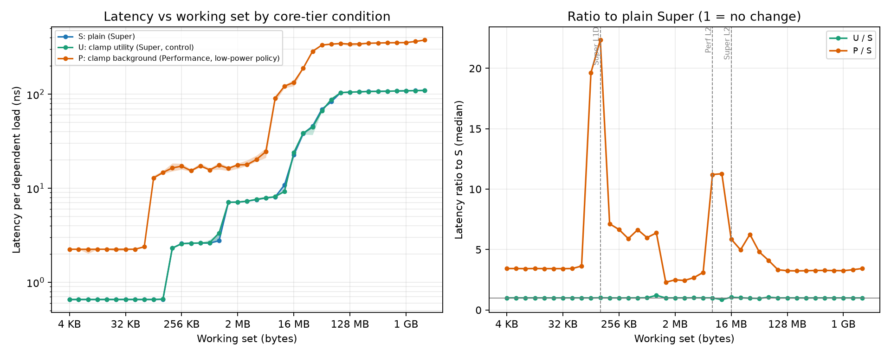

| Working set | S ns | P ns | P/S |
|---|---|---|---|
| 4 to 32 KB (L1) | 0.65 | 2.24 | 3.4 |
| 128 KB | 0.66 | 14.7 | 22.4 |
| 256 KB to 1 MB | 2.6 | 17 | 6.6 |
| 2 to 4 MB | 7.1 to 7.6 | 17.7 to 20.2 | 2.5 to 2.7 |
| 8 MB | 8.1 | 90.6 | 11.2 |
| 16 MB | 22.8 | 133.5 | 5.9 |
| 128 MB to 2 GB | 105 to 110 | 342 to 377 | 3.2 to 3.4 |

U matches S within 1% (except one noisy point at 1 MB), so the clamp mechanism is not the cause. The P curve has its L1 edge at 64 to 92 KB and its L2 edge near 8 MB, whereas S has them at 128 KB and 16 MB: the tiers' cache sizes (`docs/ENVIRONMENT.md`) show up directly. The gap is smallest for L1-resident and DRAM-resident data (3.3 to 3.4x), and peaks at the cache-size mismatch points. This supports the hypothesis that the gap widens when the working set crosses the smaller tier's L2 (11x at 8 MB), but not the claim of a gap that grows monotonically with working set: the largest spike (22x) is at the L1 boundary, which I did not predict, and the baseline 3.3x is a policy or clock effect that I cannot separate from cache effects. I therefore call H3 partly supported.

### 5.2 Bandwidth

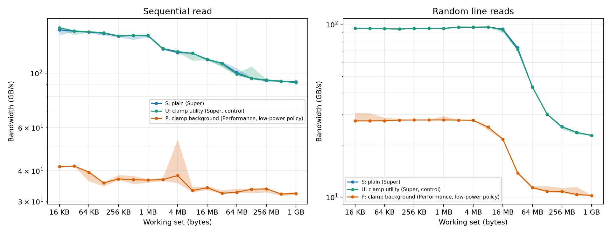

S/P for sequential read: 3.6x (16 KB), 4.1x (128 KB), 3.6x (8 MB), 2.8x (128 MB), 2.9x (1 GB). Random lines: 3.4x (16 KB), 3.8x (8 MB), 4.3x (16 MB), 2.2x (1 GB). Bandwidth ratios are flatter than latency ratios and smallest in DRAM; memory-level parallelism hides part of the capacity mismatch.

### 5.3 18 plain threads, per-thread signature

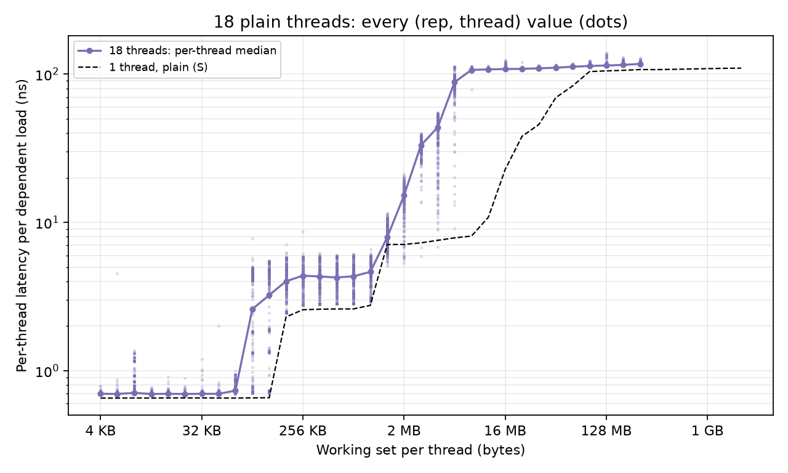

At 92 to 131 KB per thread the per-thread latency splits into two groups (q1 0.73 ns, q3 4.5 ns): threads on Super cores are still L1-resident while others are not, consistent with L1D 128 vs 64 KB at default policy. Which thread is on which core is inferred from latency, not pinned. At 8 MB per thread and above the median is already near DRAM latency (106 ns) because six threads share one 16 MB L2 and each gets under 3 MB; this is shared-cache contention, not a tier effect, and it confounds the tier comparison at those sizes.

### 5.4 Failure modes of the interaction study

The low-power policy confounds frequency and capacity effects. Shared L2 contention confounds the 18-thread condition. I did not run the optional second interaction (QoS x concurrent bandwidth hog) for latency curves; the contention results of Section 4.3 are the only load experiment.

## 6. Hypothesis scorecard

| ID | Verdict | Evidence |
|---|---|---|
| H1a latency plateaus | partly supported | 3.1 |
| H1b TLB | partly supported | 3.2 |
| H1c bandwidth and prefetcher | partly supported | 3.3 |
| H2a thread QoS idle | supported | 4.1 |
| H2b process policy idle | supported | 4.1 |
| H2c thread count | partly supported | 4.2 |
| H2d thread QoS under hog | supported | 4.3 |
| H2e process policy under hog | supported | 4.3 |
| H3 core tier x working set | partly supported | 5.1 |
| AI-resilience prediction ("nearly flat") | partly supported | 7.1 |

## 7. AI-resilience checkpoint

### 7.1 Flawed design that I built, detected and corrected: sequentially linked pointer chase

**Before.** I first implemented the plausible design where node i points to node i+1 in memory (`ChaseMode::CHASE_SEQ`, `data/raw/chase_naive_*.csv`). It passed every functional check (single cycle, checksum, no page faults) and produced a clean, low-noise curve: 0.66 ns in L1, 1.2 to 2.4 ns in L2, **7.8 ns at 1 GB**. The result looked like a fast memory system.

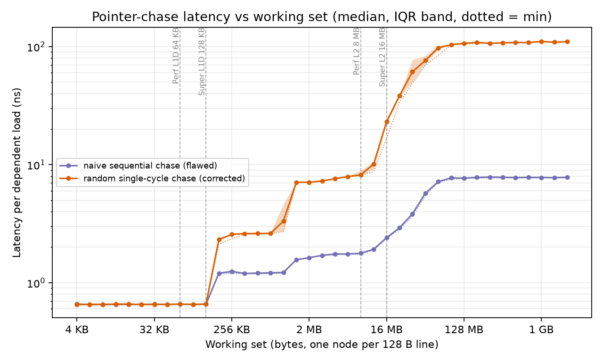

**Detection.** The known-answer check failed: DRAM latency of 7.8 ns is far below tens of ns. Further, the timing signature showed per-node cost proportional to stride, not to latency.

**Diagnosis** (`data/diagnostics/chase_loop_disassembly.txt`, `plots/ai_resilience_stride_diag.png`, `data/raw/chase_diag_*.csv`). The hot loop is `ldr x26,[x26]; subs; b.ne`, a clean dependent chain, identical for both layouts, so the compiler was not at fault. At 1 GB the sequential chase costs 7.8, 15.5 and 30.3 ns per node at strides of 128, 256 and 512 B: a constant byte rate of about 16.5 GB/s. The chase was measuring prefetcher-fed streaming bandwidth. Stride changes did not restore latency: strides from 1 KB to 64 KB stayed at 11 to 39 ns, still 3x to 10x below the 108.6 ns random chase, so the prefetcher tracks constant strides across a wide range. My prediction that larger strides would defeat the prefetcher was refuted.

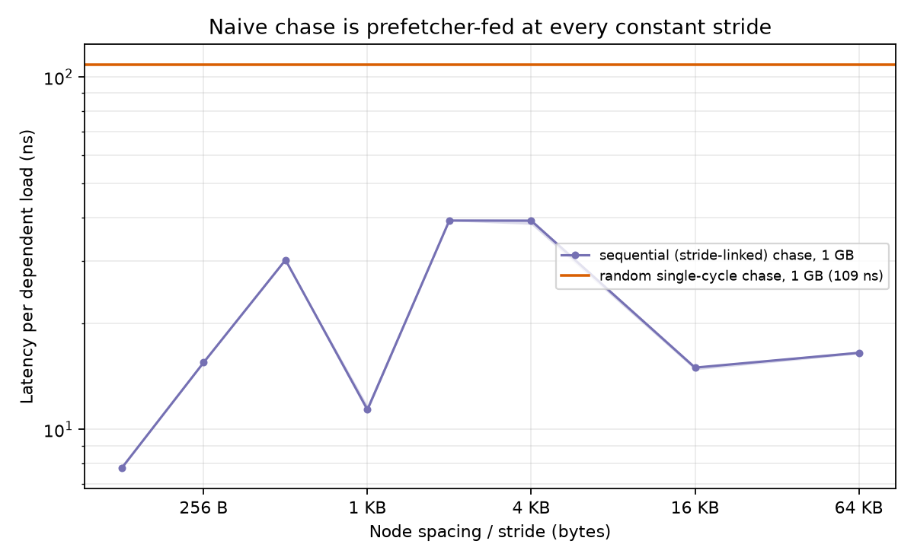

**After.** The Sattolo random single-cycle permutation gives 108 to 111 ns at 1 GB (Section 3.1). The naive curve underestimated DRAM latency by 14x.

### 7.2 Second pitfall: concluding QoS is inert from a single-thread idle test

My pilot probes (one thread, idle machine, and 36-thread hog) showed no effect of thread QoS, which suggested a "QoS does nothing" conclusion. The full sweep refuted it: with 4 or more threads, thread QoS `background` runs 3.3x slower on Performance cores (Section 4.2). The control where QoS is applied to the main thread after the workers start (`E2x`) produces the same numbers as the correct design (Section 4.3), so a result-only check cannot catch that flaw; only reading back the QoS inside each worker (`qos_seen` column) does.

### 7.3 Other corrections

A scalar sequential-read kernel first measured 62 GB/s at 64 MB; a rerun against a NEON version gave 97 vs 98 GB/s, so the low reading was a transient and my initial comment attributing it to load-slot limits was wrong (fixed in `src/bw.c`). I also accidentally started the full QoS experiment without `caffeinate` while testing a script; I killed it and discarded its partial output before the real run. Details: `docs/AI_USE.md`.

## 8. Limitations

- No thread pinning; placement is steered and sampled, not guaranteed.
- No raw cache/TLB miss counters and no frequency or power counters (no `sudo powermetrics`, per the user-approval rule); attributions of plateaus to cache levels, and of the 3.3x policy slowdown to clock, are inferred.
- Background policy confounds core tier with a low-power state, so "Performance core" results in Section 5 are not a clean microarchitecture comparison.
- One machine, one OS build (macOS 26.5.2), one fixed chase permutation seed, thermal state recorded but not controlled beyond AC power and idle machine; no run was flagged as throttled.
- Unified memory: the GPU and OS share DRAM, and macOS may compress memory; faulted rows (11 of 585) were excluded.
- The SLC size is not exposed and not identifiable from the latency ramp.
- Two bandwidth points (stride-4 and stride-16 at 1 MB) are unvalidated. The optional CUDA extension and the Linux track were not done.

## 9. Reproducibility

`./scripts/run_all.sh` rebuilds, tests, runs all experiments, and regenerates processed data and plots (about 50 minutes measured for the full profile; `QUICK=1` runs reduced sweeps). See `README.md` and Section 10 below for the clean-checkout check.

## 10. Reproduction check

On 2026-10-06 `QUICK=1 ./scripts/run_all.sh` was run on a data-free copy of the tree (built with `git archive`, excluding `data/raw`, `data/processed` and `plots`). It exited 0, passed the tests, and regenerated all 11 plots. Headline values matched the full run within about 4% (random chase at 1 GB 108.5 vs 110.5 ns; naive chase 7.76 vs 7.79 ns; background-policy compute 337 vs 344 M/s). A full-profile re-run from the clean copy was not done. Details: `README.md`, section Verification.
